# Label-Efficient Visual Imitation for Robot Manipulation

**How much action supervision does a visual robot policy need, and what makes action-free demonstrations useful?**

Robot demonstrations with recorded actions are expensive; video of the same behaviour without actions is cheap. This project studies, in a fully controlled simulation, how a vision-based manipulation policy can learn from **a few action-labelled demonstrations plus many action-free ones**, and which intermediate structure makes the action-free part useful: **inverse dynamics** (pseudo-labelling the missing actions), **latent actions** learned from frame changes, or **object-centric geometry**.

The test bed is ManiSkill 3's `PickCube-v1` (pick up a cube and hold it at a goal position) with the official ACT policy from RGB images. Simulation is the point, not a limitation: every frame comes with the true action, object poses and camera calibration, so the study can measure what real-video work cannot. That includes how accurate pseudo-labels are, what latent actions encode, and *why* a policy fails.

> **Status (2026-11-26).** Baseline and failure analysis done. Object-centric dataset pipeline done. Action-free study: inverse-dynamics (IDM) pseudo-labels collapse the policy (0/100 at two seeds, against 95–97/100 with true labels on the same demos). A controlled label-noise sweep shows that strongly structured errors break it (motion shrunk ×0.4 or ×0.7: 1 and 25/100; noise persisting over time: 52/100), while random errors as large as the IDM's do not (93/100). Every one of these results reproduces with a second training seed (see the two-seed table below). Labels built from the gripper position estimated in each image rescue the policy: 50–74/100 at seed 0, and 95/100 at seed 1 (with true gripper labels), level with the upper bound (97/100). Seed repeats showed that with mildly noisy labels the training seed alone moves success by up to 22 episodes, while with true labels it moves by 2; the finer seed-0 comparisons of sessions 7–9 were withdrawn on that basis. New (one seed, label quality only): the IDM behind arm B was trained for only 3,000 steps. Trained for 60,000 steps, the same small IDM gives far better labels (x R² 0.10 → 0.70, y 0.44 → 0.93), close to the IDM recipe of Morin et al. (2026), x 0.76, y 0.95, gripper 99% (Mac, N = 100, seed 0). So arm B's 0/100 holds for an undertrained IDM, not for IDM pseudo-labels in general. Policies on both new label sets are running on Kaggle (seeds 0 and 1), with the expected outcome written down beforehand ([plan and prediction](experiments/phase3_idm_budget.md)). Next: a third seed for these and the key noise conditions. Simulation only, nothing here claims real-robot transfer. Progress log: [experiments/status.md](experiments/status.md).

## Research thread

| | Question | Status | Main result so far |
|---|---|---|---|
| **1. Baseline and diagnosis** | How good is the standard ACT RGB policy, and why does it fail? | Done | 18/100 success (published reference 28/100, best checkpoint). It grasps 97% of the time but places the cube in only 25% of episodes. The bottleneck is goal precision, not grasping |
| **2. Object-centric data** | Can we extract synchronized RGB-D, ground-truth object/gripper geometry and camera calibration in ACT's action space? | Done | Validated on Mac and Linux; replay matches the recorded demos to 0.00 mm on Linux |
| **3. Learning from action-free demos** | With only N labelled demos, does an IDM trained on them improve the policy? | Done for N = 25, 100 | IDM labels are worse than none at N ≤ 10 and useful from N ≈ 25 by per-step accuracy, yet they collapse the policy: at N = 100 it reaches the cube in 9/100 episodes vs 97/100 without them, and succeeds 0/100 vs 95/100 with all 1,000 true labels |
| **3b. What makes pseudo-labels useful?** | Which label errors break the policy, and can labels be built to avoid them? | In progress | Random errors as large as the IDM's are harmless (93/100). At two seeds each: random errors of the IDM's size are harmless (93, 95), shrunk motion (×0.7: 25, 23; ×0.4: 1, 1) and time-correlated noise (52, 48) break it, IDM labels give 0 and 0. Gripper errors concentrated at the goal also hurt (seed 0). Labels from the gripper position estimated in each image: 50–74/100 at seed 0, 95/100 at seed 1 (true gripper), level with the upper bound (97). Mild label errors make results seed-dependent: the same labels give 76 at seed 0 and 96 at seed 1, so the seed-0 differences of sessions 7–9 were withdrawn. A third seed for the key conditions is next |
| **4. Video-only data and generality** *(next)* | Do position-based labels work when the action-free demos have no robot state at all, and on other tasks, with ≥ 3 seeds? | Planned | — |
| **5. Object-centric latent actions** *(later)* | Do actions expressed relative to the cube and goal fix the precision bottleneck and make action-free learning robust? | Planned | — |
| **6. Visual robustness** *(later)* | Which representation degrades least under camera, lighting and distractor shifts? | Planned | — |

## Key results

### 1. Baseline: grasping is solved, goal precision is not

ACT trained on 100 demos (30k steps, Kaggle T4) succeeds in **18/100** held-out trials (95% CI 12–27%). That is consistent with the ManiSkill 3 paper's 28/100, which is the best checkpoint during training ([details](docs/phase_a_baseline.md)). A failure analysis over 200 episodes per checkpoint reads the simulator state at every step. It shows the policy **grasps the cube in 97%** of episodes but brings it into the 2.5 cm goal tolerance in only **25%**. In 68% of episodes it carries the cube to about 4 cm short of the goal, usually too low, and stops ([report](results/phase_a_failure_analysis/failure_analysis_report.md)).

| Where episodes drop out | Success during training | Rollouts |
|---|---|---|
| 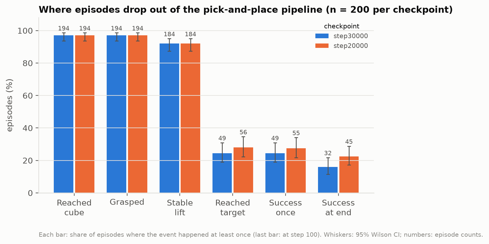 |  | 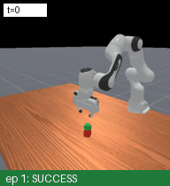 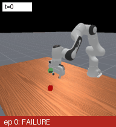 |

### 2. How well can a few labelled demos label the rest?

An inverse dynamics model (IDM) trained on N labelled demos predicts the hidden actions of 900 action-free demos (15 runs: 5 budgets × 3 seeds). With **5–10 labelled demos its movement labels are worse than predicting no motion**. From about **25** they become useful: vertical motion R² 0.63–0.81, gripper 88–95% correct. Motion along the camera's viewing axis stays hard to recover ([details](results/action_free/idm/README.md)).

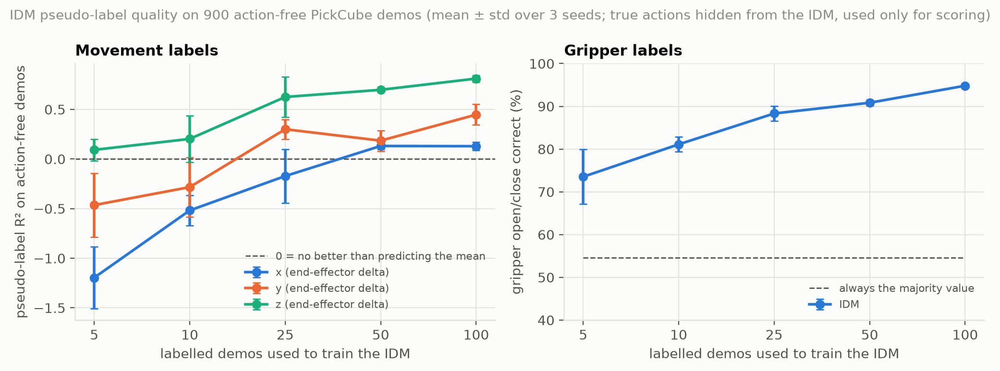

### 3. Does pseudo-labelling help the policy? No: IDM labels collapse it, at N = 25 and N = 100

> **Update (2026-11-26).** The IDM used in this section was trained for 3,000 steps, which turned out to be far too short: at 60,000 steps its labels are much better (x R² 0.10 → 0.70 at N = 100, seed 0, Mac). The results below are for this undertrained IDM. Policies on longer-trained IDM labels are running ([plan](experiments/phase3_idm_budget.md)).

At N = 25, ACT was trained on the 25 labelled demos alone (arm A) and on the same 25 plus 900 IDM-pseudo-labelled demos (arm B). Both used the same settings, seed and evaluation scenes; 12k steps each on Kaggle. Neither completes the task (0/100). The stage breakdown on 100 identical scenes separates them sharply: arm A **grasps the cube in 74%** of episodes, while arm B grasps in **14%** and mostly never reaches the cube (paired exact test p < 1e-12). At this budget the IDM's horizontal labels are worse than guessing, and training on them on 97% of the data pulled the policy off the cube. One seed; it shows label quality has to clear a threshold before pseudo-labelling helps ([details](results/action_free/policy_N25/README.md)).

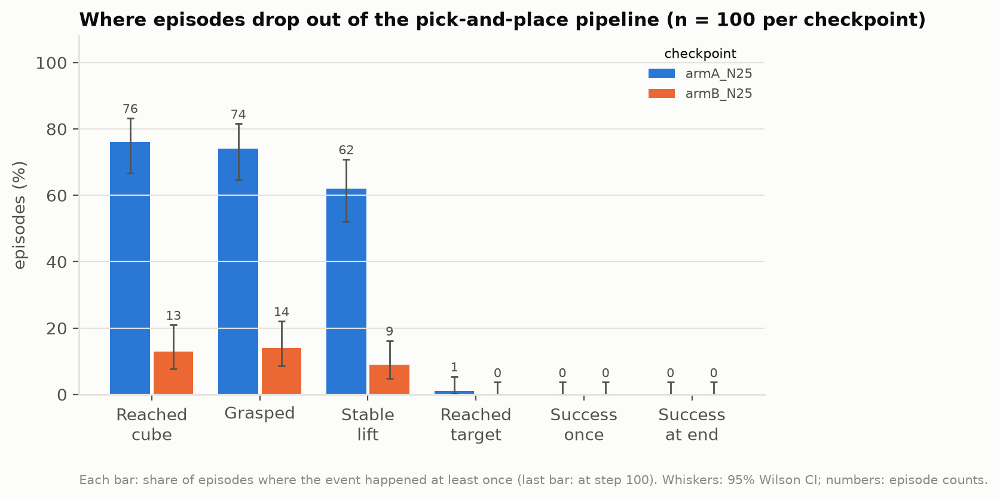

**Upper bound: the same schedule with all 1,000 demos labelled.** Same settings, seed and scenes. It succeeds in **43/100** training-time trials on the GPU simulator (95% CI 34–53%) and in **95/100** on the same 100 CPU scenes used for arms A and B (90/100 on another 100 CPU scenes). On those paired scenes it reaches the goal in 97 episodes versus 1 for arm A and 0 for arm B. So 12k steps is enough, and the N = 25 result is limited by labels, not by training length. One seed. The two simulators disagree strongly for this checkpoint. A follow-up check found that the robot does settle on GPU, but the held cube drifts just outside the 2.5 cm goal (median 3.0 cm) in 46 episodes. Even the expert demos' recorded actions fail 12/100 times on GPU vs 0/100 on CPU, so the CPU-recorded demos do not transfer exactly between simulators. CPU results are therefore the in-distribution measure ([details](results/action_free/upper_N1000/README.md)).

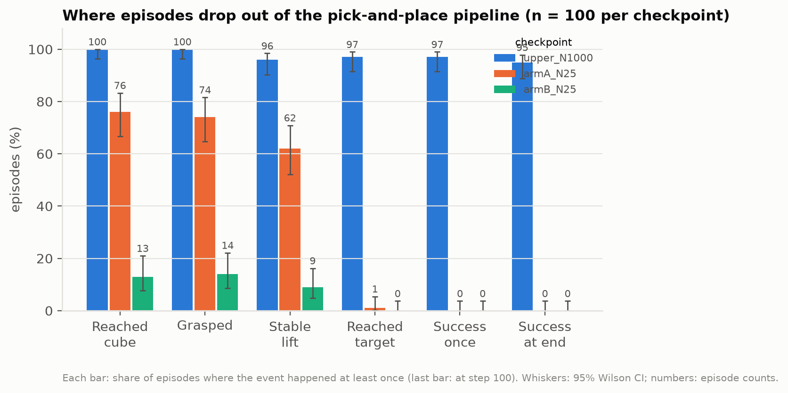

**At N = 100 the result is the same.** The IDM's labels improve (vertical R² 0.81, gripper 94%), but horizontal motion stays poorly labelled (R² 0.2–0.3). The pseudo-labelled policy again rarely reaches the cube (9/100), against 97/100 for the policy trained on the 100 labelled demos alone (paired p < 1e-25). That arm now approaches, grasps and lifts reliably (90–97%) but places the cube only rarely (3/100 success, CPU simulator). The sharpest contrast: the upper bound and the N = 100 pseudo-label arm train on the *same* 1,000 demos and images, and differ only in the action labels of 900 of them; 95/100 vs 0/100. One seed. A check with true labels in place of the pseudo-labels reproduces the upper-bound training data exactly, so the failure comes from the labels, not the pipeline ([details](results/action_free/policy_N100/README.md)).

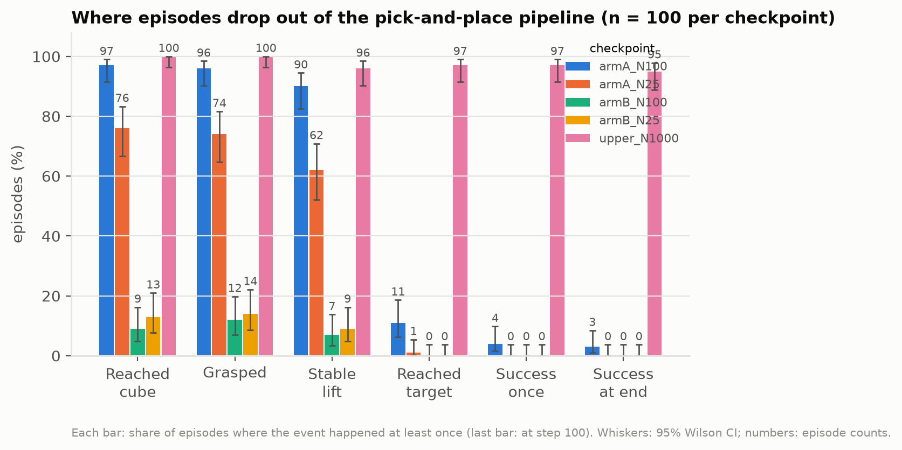

**The collapse reproduces with a second seed (session 13).** With the IDM and the policy both trained with seed 1, the pseudo-labelled policy again succeeds in **0/100** episodes, against 13/100 for the 100 labelled demos alone (paired 13 vs 0, p = 2e-4) and 97/100 for true labels on the same 1,000 demos. At this seed, adding the IDM-labelled demos is significantly worse than leaving them out ([details](results/action_free/policy_N100/README.md#seed-repeat-session-13)).

### 4. Which label errors matter? Structure, not size

**A controlled noise sweep.** Arm B (N = 100) is trained on the 900 demos' *true* actions with known errors added, so label quality is set exactly. CPU success at end on the same 100 scenes, one seed each:

| Labels for the 900 action-free demos | Per-step R² (x, y) | Success |
|---|---|---|
| True actions (upper bound) | 1.0 | 95 |
| Random noise on x, y | 0.25 / 0.5 | 93 / 93 |
| Random noise on z + 6% gripper flips (IDM level) | x, y exact | 90 |
| Noise of the same size, correlated over time | 0.25 | 52 |
| x, y scaled by 0.7, no noise | 0.91 | 25 |
| x, y scaled by 0.4, no noise | 0.64 | 1 |
| IDM pseudo-labels | about 0.2–0.3 | 0 |

Errors as large as the IDM's are harmless when random: over a 30-step action chunk they average out. The IDM's errors are not random. It shrinks horizontal motion (slope 0.27–0.47 against the true action) and its errors persist from step to step (autocorrelation 0.78–0.95), and each of these flaws breaks the policy on its own, even at high per-step R² ([details](results/action_free/noise_sweep/README.md)).

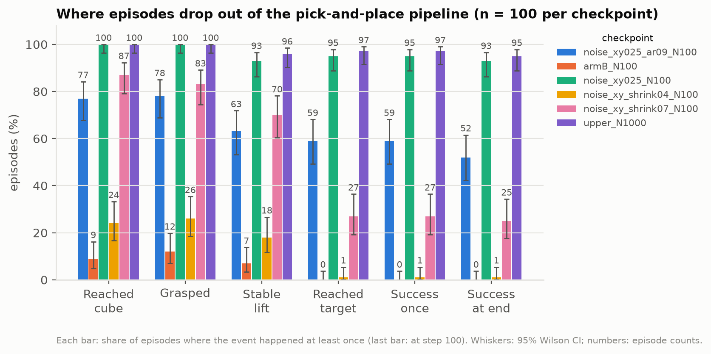

**Labels built from estimated positions.** The action in this task is almost exactly a function of how the gripper moves (with recorded positions, a linear map recovers it with R² 0.998–1.0). So instead of an IDM, a small CNN estimates the gripper position in each image (trained on the 100 labelled demos), and actions are taken as differences of positions. These labels have the right scale and errors that cancel instead of persisting. Trained on them, the policy reaches and grasps the cube in 97–100% of episodes and succeeds in **50/100**, or **57/100** when the positions are fused with the IDM's motion estimate in a Kalman smoother, against 0/100 with IDM labels ([details](results/action_free/labeller_smoke/README.md)).

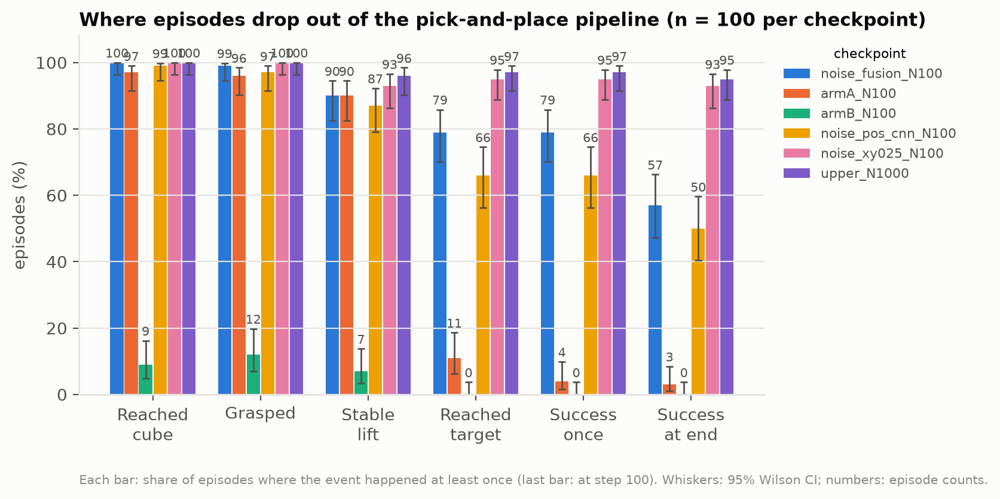

**Why not 95?** Most remaining failures release the cube at the goal. Both labellers still take the gripper channel from the IDM, which says "open" in 22.8% of steps while the cube is held still at the goal (random flips at that overall rate are harmless). Estimating the finger opening from each image cuts those errors to 1.1%. Fixing the gripper removes the drops, but not the gap: with the true gripper labels the policy succeeds in 60/100, with the image-based gripper in 53/100. The episodes that used to drop the cube now stop short and low (median 2.6 cm below the goal), the same goal-precision failure as the baseline policy. A systematic bias in the motion labels is too small to explain it (at most 0.23 cm summed over the time after the grasp, median, against a 2.6 cm miss).

**Where the gap comes from (session 7; withdrawn after session 11, seed 0 only).** Two diagnostic policies, both with true gripper labels, separate the possible causes ([details](results/action_free/noise_sweep/README.md#session-7-goal-precision-is-lost-in-the-image-based-errors-structure)):

| Labels for the 900 action-free demos (x, y, z) | Per-step R² (x, y, z) | Success |
|---|---|---|
| Recorded gripper positions → the same position-to-action map | 1.0 / 1.0 / 1.0 | 93 |
| True actions + random noise as large as the image CNN's errors | 0.42 / 0.66 / 0.79 | 88 |
| Positions estimated from images (`fusion`, true gripper) | 0.80 / 0.92 / 0.92 | 60 |

The labelling method works when the positions are right (93 vs 95 for true labels), and noise of the image estimates' size is nearly harmless when it is random (88). The image-based labels have *smaller* per-step errors yet reach only 60 (paired 33 vs 5 against the random noise, p = 4e-6). So the remaining gap is again the structure of the errors, not their size.

**What it is not, and how much single runs vary (session 8).** Moving each episode's image-based errors onto another episode, keeping their size and pattern over time, gives 72/100 against 74/100 for the unchanged labels from the same build (paired p = 0.83), so the errors do not hurt because they are tied to the scene. The unchanged labels scored 60/100 when built in session 6 and 74/100 when rebuilt in session 8 (p = 0.007): the labeller and the policy train on GPUs, which are not bit-reproducible, and one rebuild moved success by 14 episodes. What the image-based labels still carry, and random noise does not, is a mild version of the IDM's two flaws (slope 0.94–0.98, errors persisting from step to step at 0.40–0.54); session 9 tests that directly ([details](results/action_free/noise_sweep/README.md#session-8-not-scene-dependence-and-large-run-to-run-spread)).

**Mild shrink plus persistence reproduces the gap at seed 0 (session 9; withdrawn after session 11).** True actions shrunk by the image labels' slope (0.95 / 0.98 / 0.96) plus random noise that persists from step to step (ρ = 0.45), matched to their per-step accuracy, give **76/100**: level with the image-based labels (74, paired p = 0.83) and below random noise that is larger per step but neither shrunk nor persistent (88, paired 14 vs 2, p = 0.004). Per-step accuracy ranks these labels the wrong way round; the two structural properties decide. Which of the two matters more is not yet separated. A repeat of the 88 condition with identical labels gave bit-identical weights, so policy training is deterministic at a fixed seed and the session 6 vs 8 spread came from the labeller rebuild ([details](results/action_free/noise_sweep/README.md#session-9-mild-shrink-plus-persistence-reproduces-the-gap)).

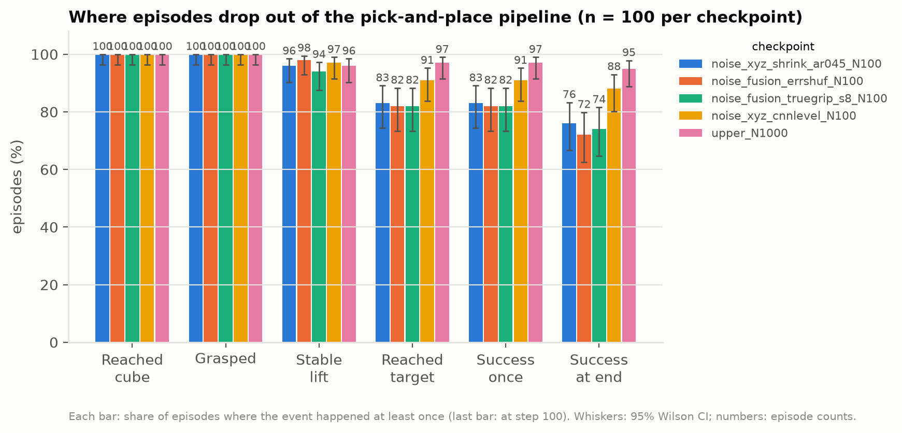

**First seed repeat: the image-based labeller reaches the upper bound (session 10).** Rebuilt and trained with seed 1, the same labeller (true gripper labels) gives **95/100**, against 97/100 for the upper bound at seed 1 (paired p = 0.63) and 74/100 for the seed-0 build in session 8 (paired 23 vs 2, p = 2e-5). Its label statistics are close to the 74 build's, and the seed changed both the labeller and the policy training, so the cause of the jump is not yet separated. The upper bound barely moves with the seed (95, 97), so noisy labels appear to make the outcome far more seed-dependent. The seed-0 comparisons of sessions 7–9 are being repeated with seeds 1 and 2 before any of them is treated as settled ([details](results/action_free/noise_sweep/README.md#session-10-seed-1-upper-bound-and-image-based-labeller)).

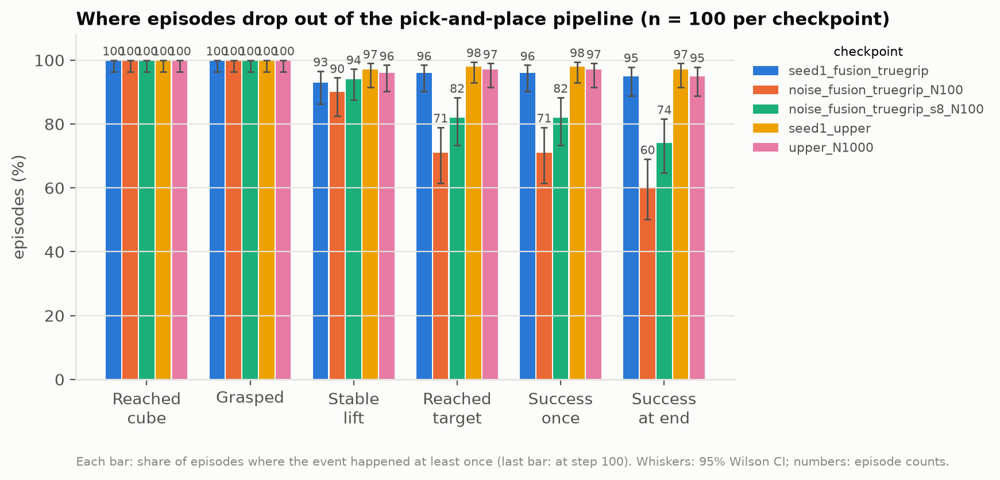

**The seed, not the labels, explains the seed-0 gaps (session 11).** Retrained with seed 1 on exactly the same labels, mild shrink + persistence goes from 76 to **96/100** (paired 22 vs 2, p = 4e-5) and CNN-sized random noise from 88 to **97/100** (11 vs 2, p = 0.02). At seed 1 every condition tried scores 95–97, level with the upper bound. So the differences between sessions 7–9 (and the 74 → 95 jump of session 10) came from the policy's training seed: with true labels the seed moves success by 2 episodes, with mild label errors by 9–22. The conclusions drawn from those seed-0 comparisons (sessions 7–9 above) are withdrawn. The large effects of sessions 1–4 (IDM labels 0, shrunk motion 1–25, persistent noise 52, against 93 for random noise) are far bigger than this seed effect but still need their own repeats ([details](results/action_free/noise_sweep/README.md#session-11-the-same-labels-with-seed-1)).

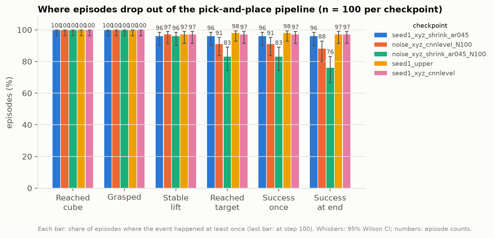

**The strong-error effects hold at a second seed (session 12).** With the same labels, seed 1 gives **48/100** for noise correlated over time (seed 0: 52) and **23/100** for motion shrunk ×0.7 (seed 0: 25), while random noise and true labels score 97 at that seed (paired 50 vs 1 and 74 vs 0, p < 1e-13). The seed that tolerates mild errors fails with strong ones, and each condition fails at the same stages at both seeds. The core finding, that the structure of label errors matters far more than their size, now rests on two seeds for these conditions ([details](results/action_free/noise_sweep/README.md#session-12-the-strong-error-effects-hold-at-seed-1)).

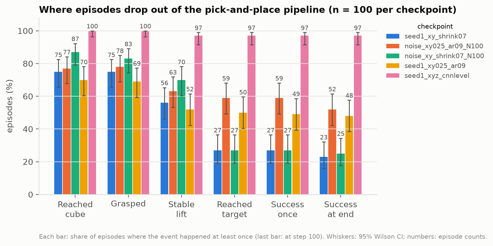

**Core result at two seeds (sessions 1–4 and 12–14).** Every condition behind the main claim has now been trained with two seeds on the same labels (the IDM is retrained with each seed). CPU success at end out of 100, same 100 scenes:

| Labels on the 900 action-free demos | Seed 0 | Seed 1 |
|---|---|---|
| True actions (upper bound) | 95 | 97 |
| Random noise of the IDM's size (x, y at R² 0.25) | 93 | 95 |
| Same-size noise persisting over time (ρ = 0.9) | 52 | 48 |
| x, y motion shrunk ×0.7, no noise (per-step R² 0.91) | 25 | 23 |
| x, y motion shrunk ×0.4, no noise (per-step R² 0.64) | 1 | 1 |
| IDM pseudo-labels | 0 | 0 |
| None: 100 labelled demos alone | 3 | 13 |

How much of the label variance is explained per step does not predict success: noise leaving R² at 0.25 is harmless, while shrinking with R² 0.91 costs 70–74 episodes. Whether errors are systematic or persist over time does. No strong-error condition moved by more than 4 episodes between seeds ([details](results/action_free/noise_sweep/README.md#session-14-every-core-result-holds-at-two-seeds)).

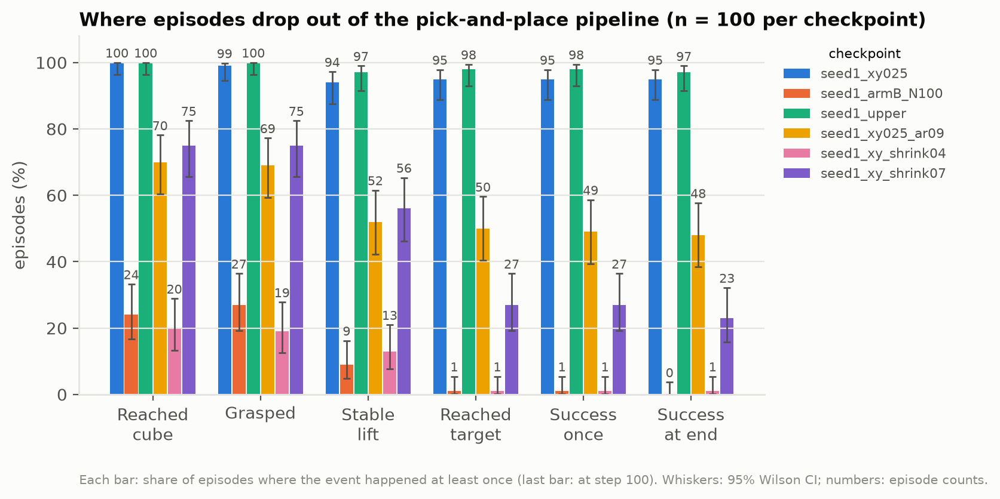

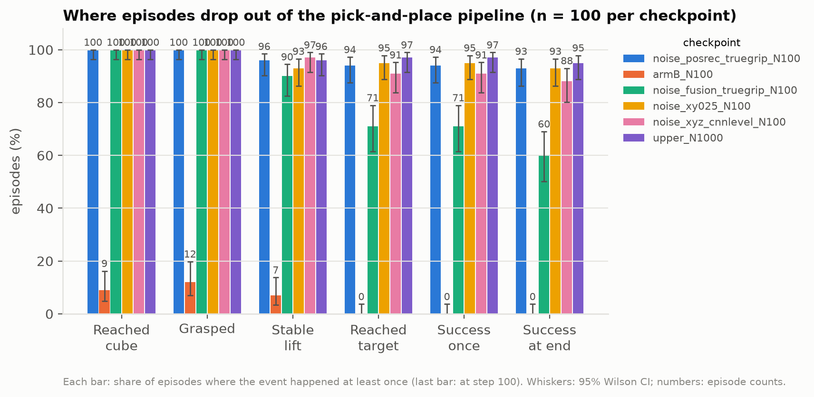

## Why this direction

- **Grounded in current work.** Latent action models (LAPO, ICLR 2024; LAPA, ICLR 2025; CLAM, 2025; LAOM, ICML 2025) and IDM pseudo-labelling (VPT, 2022; Morin et al., ICML 2026) are an active route to learning from video. Recent studies disagree on when each works ([literature review](docs/literature_action_free_video.md)).
- **An open gap.** No published study compares behaviour cloning, IDM pseudo-labelling and latent action models across action-label budgets on ManiSkill. Existing comparisons rarely measure label or latent quality against ground-truth actions.
- **A testable hypothesis from our own data.** Failures are about precise goal reaching, and the goal is not visible in the image. That suggests action-free learning should represent motion *relative to objects and goal*, which connects the object-centric data (thread 2) to the action-free study (thread 3).

Planned paper-level study: success vs number of labelled demos (5–100) for BC, IDM pseudo-labelling and a continuous latent action model with a jointly trained decoder, with ≥ 3 seeds. It adds label and latent quality measured against ground truth, failure-mode breakdowns, and an object-centric variant ([plan and compute budget](experiments/phase3_action_free_plan.md)).

## Reproduce

```bash
scripts/setup_macos.sh && source scripts/env_macos.sh      # macOS (Apple Silicon); Linux GPU: scripts/setup_linux_gpu.sh
scripts/prepare_data.sh 100                                  # official demos -> RGB, pd_ee_delta_pos
python -m pytest -q --run-slow                               # tests, incl. exact-resume and alignment checks
python scripts/train.py --config configs/baseline_act_rgb_100d.json --seed 1   # thread 1 baseline (GPU)
python scripts/failure_analysis.py <checkpoint> --label step30000 --videos      # failure analysis
python scripts/build_objectcentric_ee_delta.py                                  # thread 2 dataset
python scripts/idm_sweep.py --offsets 0 1 2                                     # thread 3 IDM label quality
OUT=results/phase3_run bash scripts/run_phase3_pair.sh                          # thread 3 policy pair (2 GPUs)
python scripts/labeller_smoke.py --out results/labellers                        # thread 3b learned labellers (IDM, position CNN, fusion)
OUT=results/noise TAG1=xy025 ARGS1="--xy-r2 0.25" TAG2=fusion ARGS2="labeller:fusion" bash scripts/run_phase3_noise.sh  # thread 3b policies (2 GPUs)
```

Full runs are meant for a CUDA GPU. Training resumes exactly from checkpoints, and evaluation scenes are fully reproducible (`enhanced_determinism`). Kaggle runners: [notebooks/kaggle_train.ipynb](notebooks/kaggle_train.ipynb), [kaggle/phase3_pair_kernel.py](kaggle/phase3_pair_kernel.py).

## Repository layout

```
src/            data, models (ACT), training, evaluation & diagnostics, action-free (IDM), visualization
scripts/        setup, data conversion, training, evaluation, failure analysis, sweeps, plotting
configs/        experiment configs
tests/          unit and end-to-end tests (resume, alignment, dataset integrity)
results/        metrics, figures and short media regenerated from logged runs
docs/           methodology, baseline report, literature review
experiments/    plans and status tracker
third_party/    unmodified ManiSkill ACT baseline (Apache-2.0)
```

Large files (demonstrations, checkpoints) are never committed; every dataset has a regeneration command.

## Acknowledgements

Built on [ManiSkill 3](https://github.com/haosulab/ManiSkill) (tag `v3.0.1`) and its ACT baseline (Apache-2.0, vendored in `third_party/maniskill_act/`). ACT: Zhao et al., "Learning Fine-Grained Bimanual Manipulation with Low-Cost Hardware", RSS 2023.
