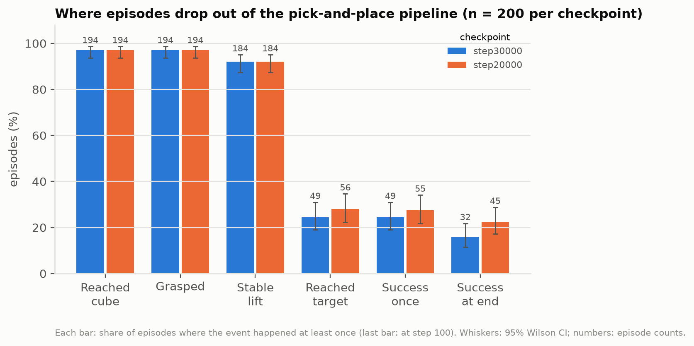
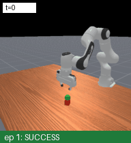
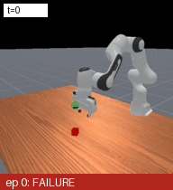
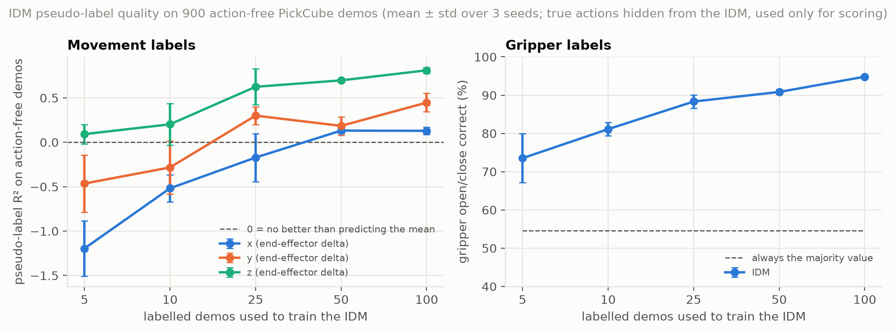
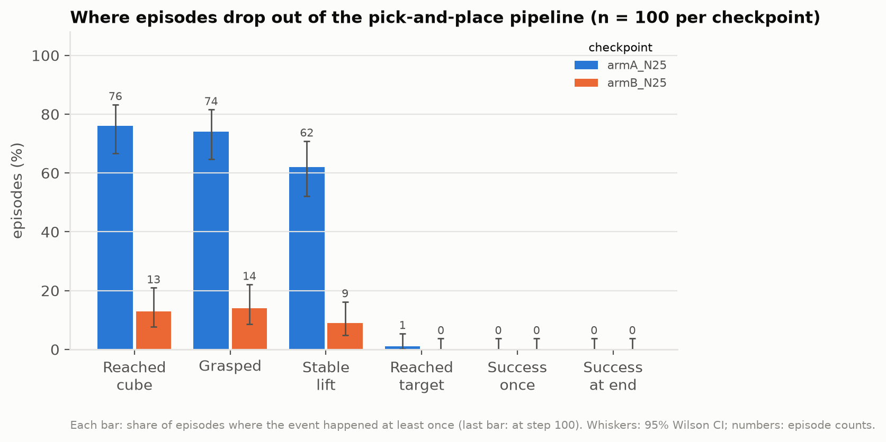
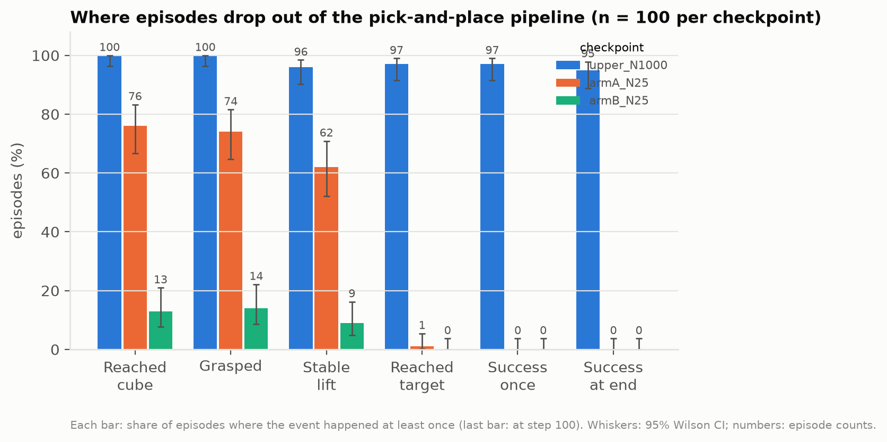
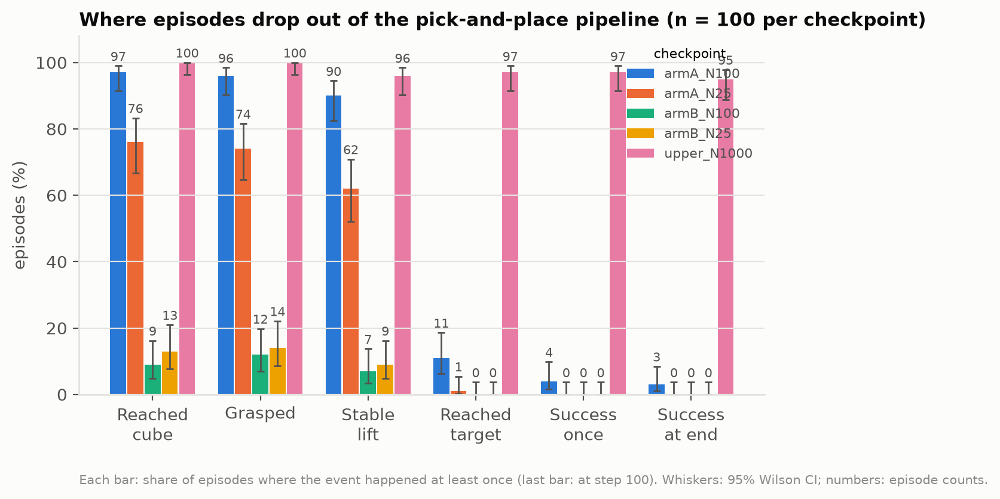

# Label-Efficient Visual Imitation for Robot Manipulation

**How much action supervision does a visual robot policy need, and what makes action-free demonstrations useful?**

Robot demonstrations with recorded actions are expensive; video of the same behaviour without actions is cheap. This project studies, in a fully controlled simulation, how a vision-based manipulation policy can learn from **a few action-labelled demonstrations plus many action-free ones**, and which intermediate structure makes the action-free part useful: **inverse dynamics** (pseudo-labelling the missing actions), **latent actions** learned from frame changes, or **object-centric geometry**.

The test bed is ManiSkill 3's `PickCube-v1` (pick up a cube and hold it at a goal position) with the official ACT policy from RGB images. Simulation is the point, not a limitation: every frame comes with the true action, object poses and camera calibration, so the study can measure what real-video work cannot. That includes how accurate pseudo-labels are, what latent actions encode, and *why* a policy fails.

> **Status (2026-11-08).** Baseline and failure analysis done. Object-centric dataset pipeline done. Action-free study: pseudo-label quality and the first policy comparison (N = 25) done. Simulation only; nothing here claims real-robot transfer. Progress log: [experiments/status.md](experiments/status.md).

## Research thread

| | Question | Status | Main result so far |
|---|---|---|---|
| **1. Baseline and diagnosis** | How good is the standard ACT RGB policy, and why does it fail? | Done | 18/100 success (published reference 28/100, best checkpoint). It grasps 97% of the time but places the cube in only 25% of episodes. The bottleneck is goal precision, not grasping |
| **2. Object-centric data** | Can we extract synchronized RGB-D, ground-truth object/gripper geometry and camera calibration in ACT's action space? | Done | Validated on Mac and Linux; replay matches the recorded demos to 0.00 mm on Linux |
| **3. Learning from action-free demos** | With only N labelled demos, does an IDM or a latent action model trained on the rest improve the policy? | In progress | IDM labels are worse than none at N ≤ 10 and useful from N ≈ 25; at N = 25 pseudo-labels hurt the policy (grasp 74% → 14%). With all 1,000 labels the same schedule reaches 43/100 (GPU) and 95/100 (CPU), so N = 25 is label-limited. At N = 100 pseudo-labels still collapse the policy (reached cube 97% → 9%) |
| **4. Object-centric latent actions** *(next)* | Do actions expressed relative to the cube and goal fix the precision bottleneck and make action-free learning robust? | Planned | — |
| **5. Visual robustness** *(next)* | Which representation degrades least under camera, lighting and distractor shifts? | Planned | — |

## Key results

### 1. Baseline: grasping is solved, goal precision is not

ACT trained on 100 demos (30k steps, Kaggle T4) succeeds in **18/100** held-out trials (95% CI 12–27%). That is consistent with the ManiSkill 3 paper's 28/100, which is the best checkpoint during training ([details](docs/phase_a_baseline.md)). A failure analysis over 200 episodes per checkpoint reads the simulator state at every step. It shows the policy **grasps the cube in 97%** of episodes but brings it into the 2.5 cm goal tolerance in only **25%**. In 68% of episodes it carries the cube to about 4 cm short of the goal, usually too low, and stops ([report](results/phase_a_failure_analysis/failure_analysis_report.md)).

| Where episodes drop out | Success during training | Rollouts |
|---|---|---|
|  |  |   |

### 2. How well can a few labelled demos label the rest?

An inverse dynamics model (IDM) trained on N labelled demos predicts the hidden actions of 900 action-free demos (15 runs: 5 budgets × 3 seeds). With **5–10 labelled demos its movement labels are worse than predicting no motion**. From about **25** they become useful: vertical motion R² 0.63–0.81, gripper 88–95% correct. Motion along the camera's viewing axis stays hard to recover ([details](results/action_free/idm/README.md)).



### 3. Does pseudo-labelling help the policy? Not at N = 25: noisy labels hurt, and 25 labels are far below the 1,000-label upper bound

At N = 25, ACT was trained on the 25 labelled demos alone (arm A) and on the same 25 plus 900 IDM-pseudo-labelled demos (arm B). Both used the same settings, seed and evaluation scenes; 12k steps each on Kaggle. Neither completes the task (0/100). The stage breakdown on 100 identical scenes separates them sharply: arm A **grasps the cube in 74%** of episodes, while arm B grasps in **14%** and mostly never reaches the cube (paired exact test p < 1e-12). At this budget the IDM's horizontal labels are worse than guessing, and training on them on 97% of the data pulled the policy off the cube. One seed; it shows label quality has to clear a threshold before pseudo-labelling helps ([details](results/action_free/policy_N25/README.md)).



**Upper bound: the same schedule with all 1,000 demos labelled.** Same settings, seed and scenes. It succeeds in **43/100** training-time trials on the GPU simulator (95% CI 34–53%) and in **95/100** on the same 100 CPU scenes used for arms A and B (90/100 on another 100 CPU scenes). On those paired scenes it reaches the goal in 97 episodes versus 1 for arm A and 0 for arm B. So 12k steps is enough, and the N = 25 result is limited by labels, not by training length. One seed. The two simulators disagree strongly for this checkpoint. A follow-up check found that the robot does settle on GPU, but the held cube drifts just outside the 2.5 cm goal (median 3.0 cm) in 46 episodes. Even the expert demos' recorded actions fail 12/100 times on GPU vs 0/100 on CPU, so the CPU-recorded demos do not transfer exactly between simulators. CPU results are therefore the in-distribution measure ([details](results/action_free/upper_N1000/README.md)).



**At N = 100 the result is the same.** The IDM's labels improve (vertical R² 0.81, gripper 94%), but horizontal motion stays poorly labelled (R² 0.2–0.3). The pseudo-labelled policy again rarely reaches the cube (9/100), against 97/100 for the policy trained on the 100 labelled demos alone (paired p < 1e-25). That arm now approaches, grasps and lifts reliably (90–97%) but places the cube only rarely (3/100 success, CPU simulator). The sharpest contrast: the upper bound and the N = 100 pseudo-label arm train on the *same* 1,000 demos and images, and differ only in the action labels of 900 of them; 95/100 vs 0/100. One seed. A check with true labels in place of the pseudo-labels reproduces the upper-bound training data exactly, so the failure comes from the labels, not the pipeline ([details](results/action_free/policy_N100/README.md)).



**Which label errors matter? First result of a controlled noise sweep.** Here arm B is trained on the 900 demos' *true* actions with known errors added. With the IDM's level of error on vertical motion (R² 0.81) and the gripper (6% of steps flipped), but true horizontal labels, the policy succeeds in **90/100** CPU episodes, against 95/100 with perfect labels (paired 6 vs 1, p = 0.125) and 0/100 with the real IDM labels. The vertical and gripper errors therefore do not explain the collapse. The matching test for horizontal errors (R² 0.25) was killed by Kaggle for running out of memory and has to be rerun. One seed; the added noise is independent across steps, unlike the IDM's errors ([details](results/action_free/noise_sweep/README.md)).

## Why this direction

- **Grounded in current work.** Latent action models (LAPO, ICLR 2024; LAPA, ICLR 2025; CLAM, 2025; LAOM, ICML 2025) and IDM pseudo-labelling (VPT, 2022; Morin et al., ICML 2026) are an active route to learning from video. Recent studies disagree on when each works ([literature review](docs/literature_action_free_video.md)).
- **An open gap.** No published study compares behaviour cloning, IDM pseudo-labelling and latent action models across action-label budgets on ManiSkill. Existing comparisons rarely measure label or latent quality against ground-truth actions.
- **A testable hypothesis from our own data.** Failures are about precise goal reaching, and the goal is not visible in the image. That suggests action-free learning should represent motion *relative to objects and goal*, which connects the object-centric data (thread 2) to the action-free study (thread 3).

Planned paper-level study: success vs number of labelled demos (5–100) for BC, IDM pseudo-labelling and a continuous latent action model with a jointly trained decoder, with ≥ 3 seeds. It adds label and latent quality measured against ground truth, failure-mode breakdowns, and an object-centric variant ([plan and compute budget](experiments/phase3_action_free_plan.md)).

## Reproduce

```bash
scripts/setup_macos.sh && source scripts/env_macos.sh      # macOS (Apple Silicon); Linux GPU: scripts/setup_linux_gpu.sh
scripts/prepare_data.sh 100                                  # official demos -> RGB, pd_ee_delta_pos
python -m pytest -q --run-slow                               # tests, incl. exact-resume and alignment checks
python scripts/train.py --config configs/baseline_act_rgb_100d.json --seed 1   # thread 1 baseline (GPU)
python scripts/failure_analysis.py <checkpoint> --label step30000 --videos      # failure analysis
python scripts/build_objectcentric_ee_delta.py                                  # thread 2 dataset
python scripts/idm_sweep.py --offsets 0 1 2                                     # thread 3 IDM label quality
OUT=results/phase3_run bash scripts/run_phase3_pair.sh                          # thread 3 policy pair (2 GPUs)
```

Full runs are meant for a CUDA GPU. Training resumes exactly from checkpoints, and evaluation scenes are fully reproducible (`enhanced_determinism`). Kaggle runners: [notebooks/kaggle_train.ipynb](notebooks/kaggle_train.ipynb), [kaggle/phase3_pair_kernel.py](kaggle/phase3_pair_kernel.py).

## Repository layout

```
src/            data, models (ACT), training, evaluation & diagnostics, action-free (IDM), visualization
scripts/        setup, data conversion, training, evaluation, failure analysis, sweeps, plotting
configs/        experiment configs
tests/          unit and end-to-end tests (resume, alignment, dataset integrity)
results/        metrics, figures and short media regenerated from logged runs
docs/           methodology, baseline report, literature review
experiments/    plans and status tracker
third_party/    unmodified ManiSkill ACT baseline (Apache-2.0)
```

Large files (demonstrations, checkpoints) are never committed; every dataset has a regeneration command.

## Acknowledgements

Built on [ManiSkill 3](https://github.com/haosulab/ManiSkill) (tag `v3.0.1`) and its ACT baseline (Apache-2.0, vendored in `third_party/maniskill_act/`). ACT: Zhao et al., "Learning Fine-Grained Bimanual Manipulation with Low-Cost Hardware", RSS 2023.
