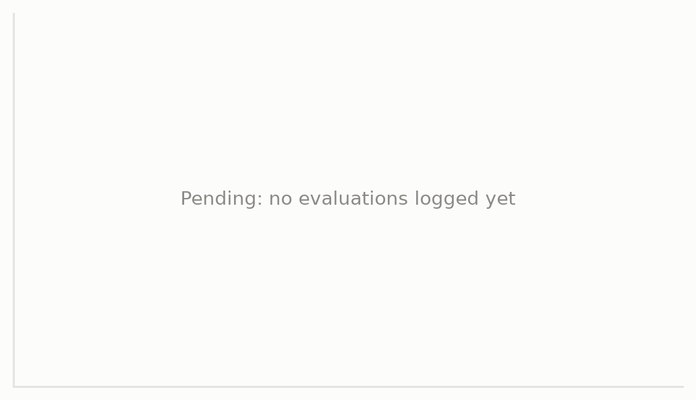

# Phase A: ACT RGB baseline on PickCube-v1 (seed 1)

Run `act_pickcube_rgb_baseline_100d_seed1`. Raw logs: `results/runs/act_pickcube_rgb_baseline_100d_seed1/`. Figures and tables regenerate with `python scripts/collect_results.py results/runs` and `python scripts/plot_results.py results/runs`.

## Setup

| | |
|---|---|
| Data | 100 official motion-planning demos, RGB 128×128 (resized to 224), `pd_ee_delta_pos`, 7,720 samples |
| Model | Official ACT (ResNet-18, chunk 30, temporal ensembling), upstream hyperparameters, batch 256 |
| Training | 30,000 updates (≈ 1,000 epochs), LR drop ×0.1 at step 20,000, EMA policy evaluated |
| Evaluation | 100 trials every 5,000 steps, scene seed 10000, max 100 steps per episode. Only the first 10 scenes were identical across evaluations (see the correction in `docs/m1_training.md`); the rest were random draws |
| Compute | Kaggle Tesla T4, one session (started 2026-11-04 07:06 UTC), 0.97 s/step, code `be7fb02` |
| Software | Python 3.13.16, torch 2.11.0+cu130, mani_skill 3.0.1, sapien 3.0.3, `physx_cuda` |

## Results (observed)

| Step | success_once | success_at_end | 95% CI, at end |
|---|---|---|---|
| 0 | 0/100 | 0/100 | 0–4% |
| 5,000 | 5/100 | 3/100 | 1–9% |
| 10,000 | 16/100 | 12/100 | 7–20% |
| 15,000 | 18/100 | 10/100 | 6–17% |
| 20,000 | 34/100 | 19/100 | 13–28% |
| 25,000 | 25/100 | 13/100 | 8–21% |
| **30,000 (final)** | **29/100** | **18/100** | **12–27%** |

**Cross-backend check.** The same final checkpoint, re-evaluated on a Mac with the CPU simulator (`physx_cpu`, 100 trials, scene seed 10000; different scenes than on GPU because the backends randomize differently): success_at_end **16/100** (10–24%), success_once **20/100**. The at-end rates agree within sampling error.

## What the run shows

- **Success plateaus while loss keeps falling.** success_at_end stays between 10% and 19% from step 10k to 30k, including after the learning-rate drop, while training loss falls from 0.0091 (step 10k) to 0.0036 (step 30k). Training loss does not predict task success here (see `fig2_training_loss`). With about 1,000 passes over 100 demonstrations, overfitting to the demos is a plausible explanation; this run does not test it.
- **Grasping is not the only problem.** success_once (29/100) exceeds success_at_end (18/100): in 11 of the 29 episodes that met the success condition at some point, it no longer held at the end. Rollouts (`results/media/act_pickcube_rgb_baseline_100d_seed1/`) show three patterns: a clean pick-and-place, a grasp followed by a drop, and hovering near the cube without a firm grasp.
- **Consistent with the earlier Colab pilot** (2% at step 5,000 there, 3/100 here).

## Limits of this result

- **One seed.** Differences of a few points between checkpoints are within noise (CIs overlap); seeds 2 and 3 are needed before quoting a baseline mean.
- **Not yet compared with ManiSkill's published ACT numbers** for this task and demo source.
- **"Best" is optimistic.** The highest checkpoint (19/100 at 20k) is selected on the evaluation scenes; the headline is the final model.
- **Dataset bytes differ between machines.** The Kaggle-converted dataset has SHA-256 `5c49d007…`, the Mac-converted one `d0f2a051…`; both have 100 episodes and 7,720 samples, and each machine reproduces its own hash. The likely cause is platform-level numerical differences in the CPU replay. A content-level comparison (actions and images) is still to do.
- Simulation only; nothing here measures real-robot transfer.
