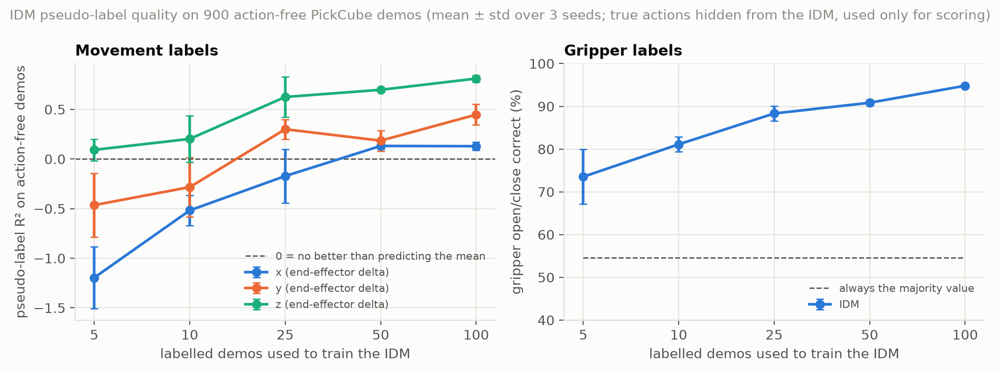

# Phase 3, step 1: IDM pseudo-label quality on action-free PickCube demos

**Question.** If only N of the expert demos keep their actions, how accurately can an inverse dynamics model (IDM) trained on those N recover the hidden actions of the other demos? This is the first half of VPT-style pseudo-labelling (Baker et al. 2022; formalised for imitation learning by Morin et al., ICML 2026). The second half, training a policy on the pseudo-labels, is the next step. Simulation makes the hidden actions available for scoring, which published IDM studies on real video cannot do.

## Setup

| | |
|---|---|
| Data | 1,000 official PickCube-v1 motion-planning demos, converted with ManiSkill's replay tool to RGB 128×128 and `pd_ee_delta_pos` (4-D actions), 1,000/1,000 successful, 77,976 transitions (macOS, `physx_cpu`) |
| Labelled pool | demos 0–99; for each N and seed, N demos are drawn at random (seeded; ids in `splits/`) |
| Action-free pool | demos 100–999 (900 demos, 70,256 transitions); their actions are never shown to the IDM and are used only for scoring |
| IDM | small CNN (4 strided conv layers + MLP) on the frame window (o_t, o_{t+1}, o_{t+2}) predicting a_t: xyz by regression, gripper by classification |
| Window choice | chosen before the sweep on a validation split inside the labelled pool (train 50, validate the other 50), never on the action-free pool: `window_selection.json` |
| Training | 3,000 steps, batch 64, Adam 1e-3, the same budget for every N; Apple MPS, about 2 minutes per run |
| Sweep | N ∈ {5, 10, 25, 50, 100} × seeds {0, 1, 2} = 15 IDMs |

## Results (mean ± std over 3 seeds; `metrics.csv`, `summary.json`)



| Labelled demos | x R² | y R² | z R² | xyz error (MAE) | Gripper correct |
|---|---|---|---|---|---|
| 5 | −1.20 ± 0.31 | −0.47 ± 0.32 | 0.09 ± 0.11 | 0.075 | 73.5 ± 6.4% |
| 10 | −0.52 ± 0.15 | −0.28 ± 0.30 | 0.20 ± 0.24 | 0.066 | 81.1 ± 1.7% |
| 25 | −0.17 ± 0.27 | 0.30 ± 0.10 | 0.63 ± 0.21 | 0.050 | 88.3 ± 1.7% |
| 50 | 0.13 ± 0.03 | 0.19 ± 0.10 | 0.70 ± 0.01 | 0.047 | 90.8 ± 0.7% |
| 100 | 0.13 ± 0.04 | 0.45 ± 0.10 | 0.81 ± 0.03 | 0.040 | 94.8 ± 0.4% |

Reference points: predicting zero motion gives xyz MAE 0.059; always predicting the more common gripper value gives 54.6%. R² below 0 means worse than predicting the mean action.

## What it shows

- **At 5–10 labelled demos the movement labels are worse than no labels.** R² is negative on x and y and the xyz error exceeds the zero-motion baseline, so a policy trained on these pseudo-labels would be pulled the wrong way. The gripper labels are already informative (74–81%).
- **From about 25 demos the labels become useful, unevenly by axis.** Vertical motion (z) is recovered well (R² 0.63–0.81), sideways motion (y) moderately (0.19–0.45), and motion along x barely (≤ 0.13 even at 100 demos). The gripper reaches 95%.
- **This sets up the policy experiment.** Pseudo-labelling can only help where its labels beat the alternative. Here that is likely N ≥ 25, and probably not at N = 5–10, the regime where it would matter most.

## Caveats

- One IDM architecture and one training budget, with no tuning beyond the frame-window choice. A stronger IDM (higher resolution, pretrained encoder, longer windows) may change the low-N picture.
- Hypothesis, not tested: x is hardest because the camera looks roughly along the x axis, so motion toward or away from it changes the image little. Typical horizontal actions are about 0.04 in normalised units (roughly 4 mm, about one pixel at 128×128), and 42–45% of x/y actions are near zero.
- Frames were rendered on macOS; Linux renders differ in a small fraction of pixels (see `results/object_centric_smoke/README.md`).
- Pseudo-label quality is not task success. Whether these labels help a policy is the next experiment.

## Reproduce

```bash
python -m mani_skill.trajectory.replay_trajectory --traj-path data/action_free/conversion/trajectory.h5 \
  --use-first-env-state -c pd_ee_delta_pos -o rgb --save-traj -b physx_cpu --count 1000   # copy of the official demos
python scripts/idm_window_select.py
python scripts/idm_sweep.py --offsets 0 1 2
python scripts/plot_idm_sweep.py
```

Pseudo-labels (15 MB, not committed) are written to `data/action_free/pseudo_labels/idm_N{n}_seed{s}.npz`.
