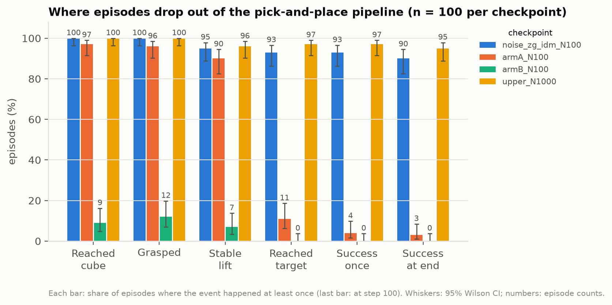
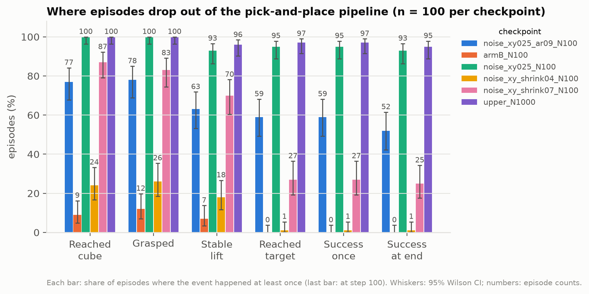

# Phase 3: label-noise sweep (sessions 1–4)

**Short answer: the *size* of the IDM's label errors is not what breaks arm B; their *structure* is, and each of
its two structural flaws hurts on its own.** Random, step-independent errors as large as the IDM's are nearly
harmless (93/100 on the CPU simulator, against 95/100 with perfect labels). True labels with the horizontal motion
shrunk, with no noise at all, fail in a dose-dependent way: ×0.7 gives **25/100** and ×0.4 gives **1/100**, although
their per-step R² (0.91 and 0.64) is far higher than that of the random noise that works. Noise of the harmless
size but correlated over time (AR(1), ρ = 0.9, no shrinkage) gives **52/100**. The real IDM labels combine both
flaws and give 0/100. One training seed per condition.

Sessions 1–2 showed that random errors of the IDM's size are harmless. Arm B
trained on the 900 action-free demos' true actions plus independent random noise as large as the IDM's error
does about as well as with perfect labels. That holds with horizontal labels at R² 0.25 (93/100 on the CPU
simulator) or 0.5 (93/100), and with vertical + gripper labels at the IDM's level (90/100). Perfect labels give
95/100, and the real IDM pseudo-labels give 0/100. The IDM's errors differ in kind: its horizontal predictions are
shrunk towards zero and the error persists from step to step. Over one 30-step action chunk its horizontal
displacement has R² 0.21–0.30, against 0.94–0.97 for the random noise. One training seed per condition.

Plan and design: [`experiments/phase3_noise_sweep.md`](../../../experiments/phase3_noise_sweep.md).

## Setup

Every condition uses the arm-B pipeline at N = 100: the 100 labelled demos with true actions plus the 900
action-free demos whose **true** actions are corrupted in a known way by `scripts/make_noisy_labels.py` (Gaussian
noise independent across steps, noise seed 0). Same ACT RGB settings, 12,000 steps, seed 0, and evaluation scenes
as the N = 100 pair and the upper bound. Runner: `scripts/run_phase3_noise.sh`; kernel:
`kaggle/phase3_noise_kernel.py`; two conditions per Kaggle session (T4 x2).

| Condition | Corruption | Achieved label quality on the 900 demos (`labels/`) | Session |
|---|---|---|---|
| `zg_idm` | z: noise to R² 0.81; gripper flipped on 6% of steps; x, y true | x 1.0, y 1.0, z 0.810, gripper 94.0% | 1 (2026-11-10, code `fee7bf4`) |
| `xy025` | x, y: noise to R² 0.25; z, gripper true | x 0.249, y 0.249, z 1.0, gripper 100% | 2 (2026-11-10, code `f585784`); killed out of memory in session 1 |
| `xy050` | x, y: noise to R² 0.5; z, gripper true | x 0.499, y 0.499, z 1.0, gripper 100% | 2 |
| `xy_shrink04` | x, y: true action × 0.4, no noise; z, gripper true | x 0.640, y 0.640, z 1.0, gripper 100% | 3 (2026-11-10, code `d0797df`) |
| `xy025_ar09` | x, y: noise to R² 0.25, AR(1) over time with ρ = 0.9; z, gripper true | x 0.253, y 0.242, z 1.0, gripper 100% | 4 (2026-11-13, code `73a79d3`); crashed before training in session 3 |
| `xy_shrink07` | x, y: true action × 0.7, no noise; z, gripper true | x 0.910, y 0.910, z 1.0, gripper 100% | 4 |
| Reference: IDM at N = 100 (`../policy_N100/`) | learned labels (Kaggle copy used by arm B) | x 0.23, y 0.29, z 0.81, gripper 94.3% | |

## Results

**Training-time success** (`physx_cuda`, out of 100; success at end / success once):

| Step | 0 | 4,000 | 8,000 | 12,000 (final) |
|---|---|---|---|---|
| `xy025` | 0 / 0 | 12 / 51 | 26 / 72 | **29 / 74** (95% CI 21–39% at end) |
| `xy050` | 0 / 0 | 12 / 54 | 26 / 74 | **33 / 80** (CI 25–43%) |
| `zg_idm` | 0 / 0 | 19 / 62 | 30 / 84 | **31 / 82** (CI 23–41%) |
| `xy_shrink04` | 0 / 0 | 1 / 1 | 2 / 4 | **2 / 3** (CI 1–7%) |
| `xy_shrink07` | 0 / 0 | 14 / 25 | 22 / 36 | **20 / 31** (CI 13–29%) |
| `xy025_ar09` | 0 / 0 | 14 / 45 | 25 / 55 | **27 / 47** (CI 19–36%) |
| Upper bound, all true labels (`../upper_N1000/`) | 0 / 0 | 19 / 74 | 33 / 84 | 43 / 87 (CI 34–53%) |
| Arm B, IDM pseudo-labels (`../policy_N100/`) | 0 / 0 | 1 / 1 | 0 / 1 | 1 / 1 |

On the GPU simulator the three random-noise conditions end 10–14 episodes below the upper bound. These runs are unpaired,
the CIs overlap, and the GPU simulator understates every policy trained on these CPU-recorded demos
(`../upper_N1000/gpu_gap_check/`). The paired CPU comparison below is the main measure.

**Stage breakdown on the CPU simulator** (`physx_cpu`, scene seed 10000, the same 100 scenes as arms A, B and the
upper bound; `failure_analysis/`, comparison in `compare_N100/`):

| | Reached cube | Grasped | Stable lift | Reached target | Success once | Success at end |
|---|---|---|---|---|---|---|
| `xy025` (noisy x, y at R² 0.25) | 100 | 100 | 93 | 95 | 95 | **93** |
| `xy050` (noisy x, y at R² 0.5) | 100 | 100 | 94 | 95 | 95 | **93** |
| `zg_idm` (noisy z + gripper) | 100 | 100 | 95 | 93 | 93 | **90** |
| `xy_shrink07` (x, y × 0.7, no noise) | 87 | 83 | 70 | 27 | 27 | **25** |
| `xy_shrink04` (x, y × 0.4, no noise) | 24 | 26 | 18 | 1 | 1 | **1** |
| `xy025_ar09` (x, y noise at R² 0.25, correlated over time) | 77 | 78 | 63 | 59 | 59 | **52** |
| Upper bound (all true) | 100 | 100 | 96 | 97 | 97 | 95 |
| Arm A, 100 labelled only | 97 | 96 | 90 | 11 | 4 | 3 |
| Arm B, + IDM pseudo-labels | 9 | 12 | 7 | 0 | 0 | 0 |

The structure conditions side by side (`compare_structure/`: random noise, correlated noise, both shrink factors,
arm B, upper bound):

**Paired exact McNemar tests on the same 100 scenes** (episodes where only the first / only the second succeeds;
`paired_tests.json`):

| Comparison | Reached target | Success at end |
|---|---|---|
| Upper bound vs `xy025` | 3 vs 1, p = 0.63 | 5 vs 3, p = 0.73 |
| Upper bound vs `xy050` | 3 vs 1, p = 0.63 | 5 vs 3, p = 0.73 |
| Upper bound vs `zg_idm` | 5 vs 1, p = 0.22 | 6 vs 1, p = 0.125 |
| `xy050` vs `xy025` | 1 vs 1, p = 1 | 1 vs 1, p = 1 |
| `xy025` vs arm B | 95 vs 0, p = 5e-29 | 93 vs 0, p = 2e-28 |
| `xy025` vs arm A | 84 vs 0, p = 1e-25 | 90 vs 0, p = 2e-27 |
| `zg_idm` vs arm B | 93 vs 0, p = 2e-28 | 90 vs 0, p = 2e-27 |
| Upper bound vs `xy_shrink04` | 96 vs 0, p = 3e-29 | 94 vs 0, p = 1e-28 |
| `xy025` vs `xy_shrink04` | 94 vs 0, p = 1e-28 | 92 vs 0, p = 4e-28 |
| Arm A vs `xy_shrink04` | 10 vs 0, p = 0.002 | 3 vs 1, p = 0.63 |
| `xy_shrink04` vs arm B | 1 vs 0, p = 1 | 1 vs 0, p = 1 |
| Upper bound vs `xy_shrink07` | 70 vs 0, p = 2e-21 | 70 vs 0, p = 2e-21 |
| `xy_shrink07` vs `xy_shrink04` | 26 vs 0, p = 3e-8 | 24 vs 0, p = 1e-7 |
| Upper bound vs `xy025_ar09` | 40 vs 2, p = 4e-10 | 46 vs 3, p = 7e-11 |
| `xy025` vs `xy025_ar09` (same noise size, independent vs correlated) | 37 vs 1, p = 3e-10 | 42 vs 1, p = 1e-11 |
| `xy025_ar09` vs `xy_shrink07` | 40 vs 8, p = 3e-6 | 36 vs 9, p = 7e-5 |
| `xy025_ar09` vs arm B | 59 vs 0, p = 3e-18 | 52 vs 0, p = 4e-16 |

Reaching the cube (paired): upper bound vs `xy_shrink04` 76 vs 0 (p = 3e-23); arm A vs `xy_shrink04` 73 vs 0
(p = 2e-22); `xy_shrink04` vs arm B 23 vs 8 (p = 0.011).

The `xy_shrink04` episodes break down as follows (`compare_N100/figures/failure_categories.png`): 73 neither grasped
the cube nor brought the gripper within 3 cm of its centre, 1 came that close but never grasped, 18 grasped and held but never reached the target, 7 lost the grasp
before the target, and 1 succeeded. (A grasp can register without the 3 cm approach, so 26 grasped although only 24
"reached the cube".) Adding the 900 shrunk demos makes the policy worse than training on the 100
labelled demos alone (arm A reaches the cube in 97/100). This is the same pattern as arm B with IDM labels.

## Why random noise is harmless and the IDM's errors are not

`scripts/label_error_structure.py` compares the labels with the true actions of the 900 action-free demos
(`label_error_structure.json`). The IDM rows are the three Mac copies of the N = 100 IDM (seeds 0–2, from the
IDM study); the Kaggle copy that arm B trained on was not downloaded, and its step R² (x 0.23, y 0.29) lies in the
same range. Values for x / y:

| Labels | Step R² | Slope of label on true action | Error autocorrelation, step to step | R² of 30-step displacement |
|---|---|---|---|---|
| IDM N = 100, seed 0 | 0.10 / 0.44 | 0.35 / 0.56 | 0.91 / 0.87 | 0.22 / 0.58 |
| IDM N = 100, seed 1 | 0.10 / 0.58 | 0.47 / 0.68 | 0.89 / 0.78 | 0.30 / 0.68 |
| IDM N = 100, seed 2 | 0.19 / 0.32 | 0.27 / 0.48 | 0.95 / 0.91 | 0.25 / 0.32 |
| `xy025` (random noise) | 0.25 / 0.25 | 1.00 / 1.00 | 0.00 / 0.00 | 0.95 / 0.94 |
| `xy050` (random noise) | 0.50 / 0.50 | 1.00 / 1.00 | 0.00 / 0.00 | 0.97 / 0.96 |
| `xy_shrink04` (scaled, no noise) | 0.64 / 0.64 | 0.40 / 0.40 | 0.99 / 0.99 | 0.64 / 0.64 |
| `xy_shrink07` (scaled, no noise) | 0.91 / 0.91 | 0.70 / 0.70 | 0.99 / 0.99 | 0.91 / 0.91 |
| `xy025_ar09` (correlated noise) | 0.25 / 0.24 | 1.01 / 1.00 | 0.90 / 0.90 | 0.34 / 0.19 |

Two differences stand out:

- **The IDM shrinks horizontal motion.** The least-squares slope of its x labels on the true x actions is
  0.27–0.47, so the labelled demos look as if the arm moved much less sideways than it did. Random noise keeps the scale (slope 1.0).
- **The IDM's errors persist.** Consecutive errors correlate at 0.78–0.95, so they do not cancel over an action
  chunk. Random noise is independent, so over the 30 steps ACT predicts at once it averages out: the summed
  displacement is still accurate (R² 0.94–0.97), even at per-step R² 0.25. For the IDM it is not (0.21–0.68).

Per-step R² therefore hides what matters to this policy. Sessions 3–4 tested both properties directly, each
alone:

- **Shrinkage alone breaks the policy, and more shrinkage breaks it more.** Scale 1.0 / 0.7 / 0.4 gives 95 / 25 / 1
  successes. At ×0.7 the policy still reaches and grasps the cube (87 / 83) but rarely carries it to the goal: in 44
  episodes it holds the cube and never gets there. At ×0.4 it mostly does not reach the cube (24). This fits the
  policy learning to move less far than the task needs, an interpretation not tested directly.
- **Correlated noise alone also hurts, though less.** At the same per-step quality, correlated noise gives 52/100
  against 93/100 for independent noise (paired 42 vs 1, p = 1e-11). Its failures are spread over the pipeline: 21
  episodes never reach the cube, and once the cube is grasped the policy usually succeeds.
- Neither flaw alone reproduces arm B's 0/100; the IDM labels have both, with slope 0.27–0.47 (around and below the
  stronger shrink tested) and autocorrelation 0.78–0.95. Whether the combination fully explains arm B is not tested.

## Caveats

- One training seed and one noise seed per condition; 100 evaluation scenes.
- The error-structure numbers come from the Mac IDM copies, not the exact labels arm B trained on.
- Two shrink factors (0.4, 0.7) were tested; where between 0.7 and 1.0 the policy starts to fail is unknown.
- On the GPU simulator the session-4 conditions score lower (27 and 20/100) than on the CPU (52 and 25/100), in the
  same order; the CPU simulator matches how the demos were recorded and is the main measure here.
- Results are read on the CPU simulator, which matches how the demos were recorded.

## Session 1: `xy025` killed out of memory, and the fix

In session 1, `train.py` kept every training frame in RAM at 224×224 (`src/data/demo_dataset.py`): about
78,000 × 3 × 224 × 224 bytes ≈ 11.7 GB per 1,000-demo run. Two such runs in parallel exceeded the Kaggle machine's
memory, and `xy025` was killed about 6 minutes into training (exit 137; its logs are kept in
`runs/xy025_session1_oom/`). `zg_idm` ran on and is unaffected.

The loader now keeps frames at their recorded 128×128 and resizes each sample to 224×224 when it is read
(about 3.8 GB per run). It is the same resize on the same frames. `scripts/check_lazy_resize.py` found 0
differing pixels over 7,720 samples on the Mac (torch 2.6) and over 3,760 samples on Kaggle before session 2's
training (torch 2.11; `runs/session2_kernel_summary.txt`). Training speed was unchanged (0.92–1.01 s/step in
session 2, against 0.96 for the upper bound).

## Session 3: `xy025_ar09` crashed before training (rerun in session 4)

Both runs passed the resize check (0 differing pixels over 3,760 samples, `runs/session3_kernel_summary.txt`) and
started training together. `xy025_ar09` died with a bus error (exit 135). It had written its session record, but its
log stops after the ResNet weights download, before its first evaluation (`runs/xy025_ar09_session3_crash/`).
`xy_shrink04` on the other GPU ran to completion. The cause is not confirmed. Python's output was buffered, so the
log probably lost the last lines. One candidate is the two processes downloading the PhysX GPU library into the same
folder at the same moment. Both runs did that in session 2 without a crash, so this is a guess. Bus errors are
also typical when shared memory runs out. Session 4 loaded the library once before the parallel start
(`scripts/run_phase3_noise.sh`) and ran Python unbuffered; both runs completed (`runs/session4_kernel_summary.txt`).

## Files

- `labels/`: corruption settings and achieved label quality of each condition (from `make_noisy_labels.py`).
- `runs/<condition>/`: config, sessions, metrics and training log from the Kaggle output (checkpoints not
  committed); `runs/xy025_session1_oom/`: the killed session-1 attempt; `runs/xy025_ar09_session3_crash/`: the crashed
  session-3 run; `runs/session{2,3,4}_kernel_summary.txt`.
- `failure_analysis/`: CPU stage analysis of each final checkpoint (`scripts/failure_analysis.py`,
  100 episodes, 10 envs, scene seed 10000).
- `compare_N100/`: combined summary and figures with arm B (N = 100) and the upper bound (sessions 1–3).
- `compare_structure/`: random vs correlated noise vs shrinkage, with arm B and the upper bound (sessions 2–4).
- `paired_tests.json`: counts and exact McNemar tests (each entry: only-first, only-second, p).
- `label_error_structure.json`: label error statistics (IDM vs controlled noise).
