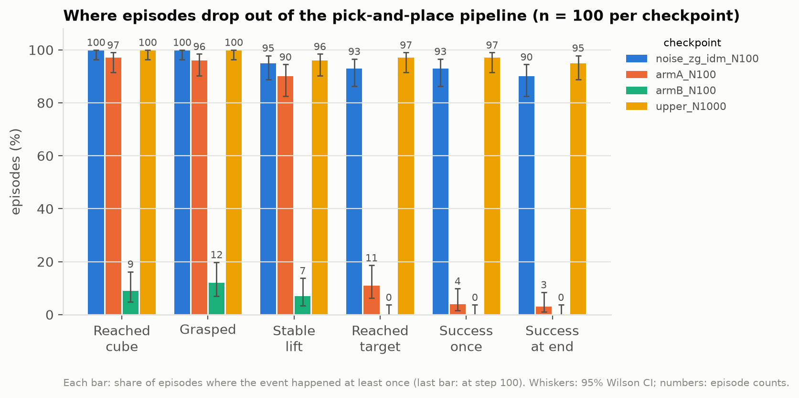
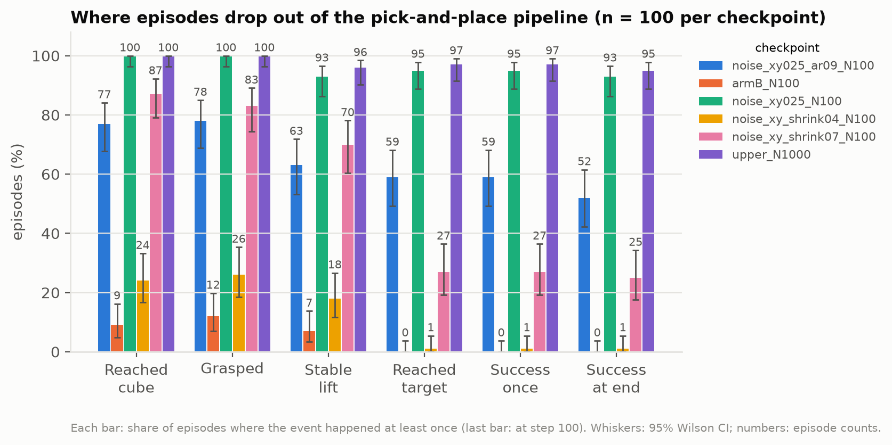
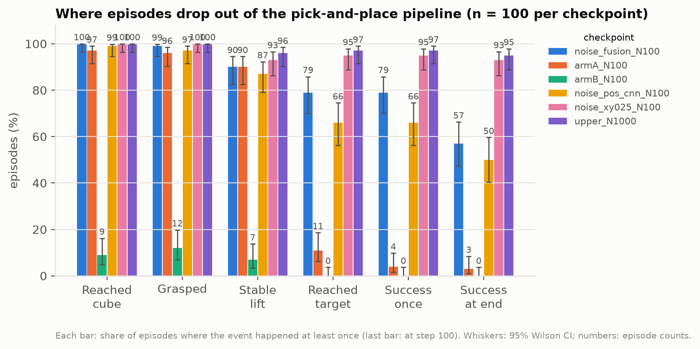
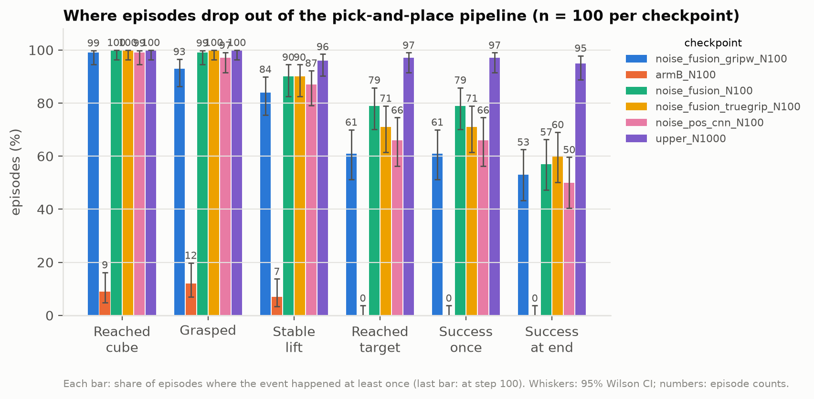
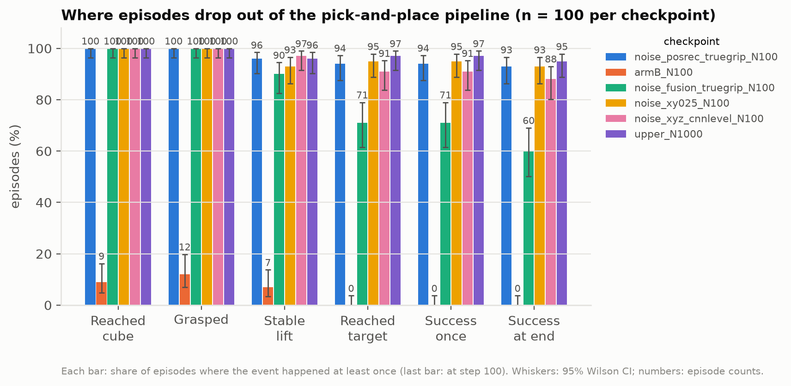
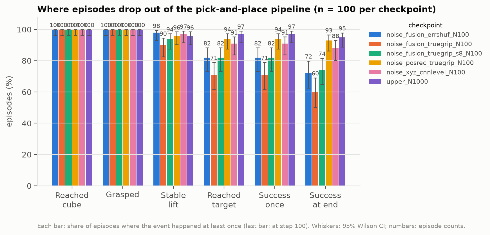
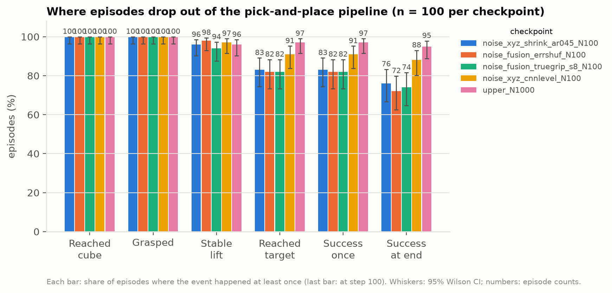
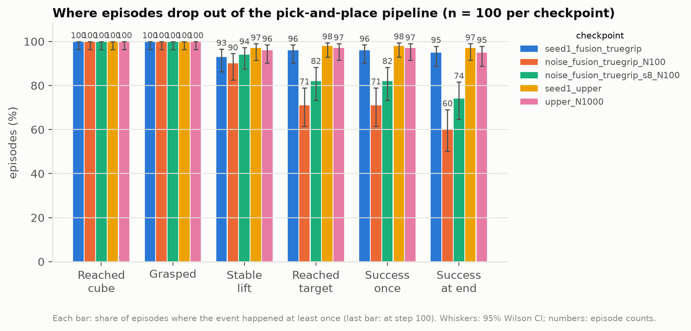
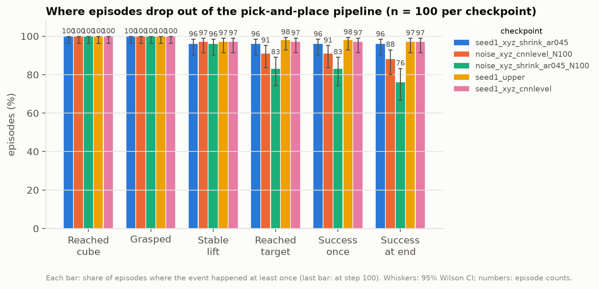

# Phase 3: label-noise sweep (sessions 1–11)

> **Update after session 11 (2026-11-19).** The seed repeats changed the reading of sessions 7–9. With seed 1 and
> identical labels, the conditions that differed at seed 0 (74–88) all score 95–97, level with the upper bound. Their
> seed-0 differences came from the policy's training seed, not from the labels. The paragraphs and sections for
> sessions 7–9 below are kept as the record of what was run and concluded at the time; see
> [Session 11](#session-11-the-same-labels-with-seed-1) for the current reading.

**Short answer: the *size* of the IDM's label errors is not what breaks arm B; their *structure* is, and each of
its two structural flaws hurts on its own.** Random, step-independent errors as large as the IDM's are nearly
harmless (93/100 on the CPU simulator, against 95/100 with perfect labels). True labels with the horizontal motion
shrunk, with no noise at all, fail in a dose-dependent way: ×0.7 gives **25/100** and ×0.4 gives **1/100**, although
their per-step R² (0.91 and 0.64) is far higher than that of the random noise that works. Noise of the harmless
size but correlated over time (AR(1), ρ = 0.9, no shrinkage) gives **52/100**. The real IDM labels combine both
flaws and give 0/100. One training seed per condition.

**Session 7 (2026-11-16): the gap left by image-based labels is also structure, not size.** Labels built from the
recorded gripper positions (with the true gripper) train a policy to **93/100**, level with true labels (95). Random
noise on x, y and z at the image CNN's per-step level (R² 0.42 / 0.66 / 0.79) gives **88/100**. The best
image-based labels, whose per-step errors are *smaller* (R² 0.80 / 0.92 / 0.92), give 60/100. So neither the
position-to-action map nor the amount of noise explains the gap; something about how the image-based errors are
structured does.

**Session 8 (2026-11-17): the errors do not hurt because they depend on the scene, and rebuilding the same labeller
moves success by 14 episodes.** Moving each episode's image-based errors onto another episode (same size, shrink
and pattern over time) gives 72/100 against 74/100 for the unchanged labels from the same build (paired 10 vs 12,
p = 0.83). The unchanged labels themselves scored 60/100 in session 6 and 74/100 here (paired 19 vs 5, p = 0.007):
one rebuild of the labeller plus one retraining, both on non-deterministic GPUs, changes the result that much. Single
runs of learned labellers therefore need repeats before small differences mean anything.

**Session 9 (2026-11-18): random noise with the image-based labels' mild shrink and persistence does as badly as
those labels.** True actions shrunk by the image labels' slope (0.95 / 0.98 / 0.96) plus random noise that persists
from step to step (AR(1), ρ = 0.45), at their per-step R² (0.88 / 0.93 / 0.95), give **76/100**. That is level with
the image-based labels from the same build (74; paired 12 vs 10, p = 0.83) and clearly below random noise that is
*larger* but neither shrunk nor persistent (88; paired 2 vs 14, p = 0.004). So the mild shrink and persistence are
enough to reproduce the gap; which of the two matters more is untested. A repeat of the 88 condition with identical
labels gave a bit-identical policy: given the labels and the seed, training on Kaggle is deterministic, so the
60 vs 74 spread of sessions 6 and 8 came from rebuilding the labeller, not from training. One seed per condition.

**Session 10 (2026-11-19): with seed 1 the image-based labeller matches the upper bound, so the seed-0 gaps above
are not settled.** The labeller rebuilt with seed 1 (`fusion_truegrip`, true gripper) trains a policy to **95/100**,
against 97/100 for the upper bound at seed 1 (paired 1 vs 3, p = 0.63). Its labels look like session 8's (step R²
0.88 / 0.95 / 0.96, slope 0.96–0.98, error autocorrelation 0.38–0.52), which reached 74/100 at seed 0 (paired
23 vs 2, p = 2e-5). The seed changes both the labeller and the policy's training, so which of the two caused the jump
is not separated. The upper bound hardly moves between seeds (95, 97). Until the synthetic conditions are repeated
with other seeds (sessions 11–13), the conclusions of sessions 7–9 hold only for training seed 0.

**Session 11 (2026-11-19): the seed-0 differences of sessions 7–10 were caused by the policy's training seed, not by
the labels.** With exactly the same labels as at seed 0, seed 1 gives **96/100** for mild shrink + persistence (seed 0:
76; paired 22 vs 2, p = 4e-5) and **97/100** for CNN-sized random noise (seed 0: 88; 11 vs 2, p = 0.02). At seed 1 all
four conditions tried so far score 95–97, level with each other and with the upper bound (all paired p ≥ 0.63). So
mild label errors (step R² about 0.4–0.95, slope ≥ 0.95, persistence ≤ 0.55) cost nothing at seed 1 and up to 21
episodes at seed 0, while true labels score 95 and 97. The labeller's jump from 74 to 95 in session 10 is explained by
the same seed effect. The claim of session 9, that mild shrink and persistence explain the image labels' gap, is
withdrawn: it held only for seed 0. Two seeds per condition; the strong-error results of sessions 1–4 (IDM labels 0,
×0.4 shrink 1, ×0.7 shrink 25, ρ = 0.9 noise 52) have not yet been repeated with another seed.

Sessions 1–2 showed that random errors of the IDM's size are harmless. Arm B
trained on the 900 action-free demos' true actions plus independent random noise as large as the IDM's error
does about as well as with perfect labels. That holds with horizontal labels at R² 0.25 (93/100 on the CPU
simulator) or 0.5 (93/100), and with vertical + gripper labels at the IDM's level (90/100). Perfect labels give
95/100, and the real IDM pseudo-labels give 0/100. The IDM's errors differ in kind: its horizontal predictions are
shrunk towards zero and the error persists from step to step. Over one 30-step action chunk its horizontal
displacement has R² 0.21–0.30, against 0.94–0.97 for the random noise. One training seed per condition.

Plan and design: [`experiments/phase3_noise_sweep.md`](../../../experiments/phase3_noise_sweep.md).

## Setup

Every condition uses the arm-B pipeline at N = 100: the 100 labelled demos with true actions plus the 900
action-free demos whose **true** actions are corrupted in a known way by `scripts/make_noisy_labels.py` (Gaussian
noise independent across steps, noise seed 0). Same ACT RGB settings, 12,000 steps, seed 0, and evaluation scenes
as the N = 100 pair and the upper bound. Runner: `scripts/run_phase3_noise.sh`; kernel:
`kaggle/phase3_noise_kernel.py`; two conditions per Kaggle session (T4 x2).

| Condition | Corruption | Achieved label quality on the 900 demos (`labels/`) | Session |
|---|---|---|---|
| `zg_idm` | z: noise to R² 0.81; gripper flipped on 6% of steps; x, y true | x 1.0, y 1.0, z 0.810, gripper 94.0% | 1 (2026-11-10, code `fee7bf4`) |
| `xy025` | x, y: noise to R² 0.25; z, gripper true | x 0.249, y 0.249, z 1.0, gripper 100% | 2 (2026-11-10, code `f585784`); killed out of memory in session 1 |
| `xy050` | x, y: noise to R² 0.5; z, gripper true | x 0.499, y 0.499, z 1.0, gripper 100% | 2 |
| `xy_shrink04` | x, y: true action × 0.4, no noise; z, gripper true | x 0.640, y 0.640, z 1.0, gripper 100% | 3 (2026-11-10, code `d0797df`) |
| `xy025_ar09` | x, y: noise to R² 0.25, AR(1) over time with ρ = 0.9; z, gripper true | x 0.253, y 0.242, z 1.0, gripper 100% | 4 (2026-11-13, code `73a79d3`); crashed before training in session 3 |
| `xy_shrink07` | x, y: true action × 0.7, no noise; z, gripper true | x 0.910, y 0.910, z 1.0, gripper 100% | 4 |
| `pos_cnn` | learned: gripper position from each image (CNN), actions from position differences; gripper from the IDM | x 0.214, y 0.606, z 0.773, gripper 92.3% | 5 (2026-11-15, code `71d2895`) |
| `fusion` | learned: Kalman/RTS smoother of CNN positions and IDM motion; gripper from the IDM | x 0.886, y 0.949, z 0.955, gripper 92.3% | 5 |
| `fusion_truegrip` | `fusion` x, y, z (rebuilt in session 6) + the true gripper command (diagnostic) | x 0.799, y 0.919, z 0.921, gripper 100% | 6 (2026-11-16, code `c4a69fc`) |
| `fusion_gripw` | same x, y, z + gripper from the finger opening estimated in each image | x 0.799, y 0.919, z 0.921, gripper 95.8% | 6 |
| `posrec_truegrip` | diagnostic: recorded gripper positions (`tcp_pose`), the same position-to-action map; true gripper | x 0.998, y 1.000, z 1.000, gripper 100% | 7 (2026-11-16, code `f5c967a`) |
| `xyz_cnnlevel` | x, y, z: random noise to the position CNN's Mac step R² (0.42 / 0.66 / 0.79); gripper true | x 0.419, y 0.659, z 0.790, gripper 100% | 7 |
| `fusion_truegrip_s8` | `fusion_truegrip` rebuilt in session 8 (matched control for `fusion_errshuf`) | x 0.877, y 0.930, z 0.955, gripper 100% | 8 (2026-11-17, code `54755eb`) |
| `fusion_errshuf` | `fusion_truegrip_s8` with each episode's x, y, z residual error (label minus slope × true action) taken from another episode of similar length; true gripper | x 0.876, y 0.930, z 0.955, gripper 100% | 8 |
| `xyz_shrink_ar045` | x, y, z: true action × 0.947 / 0.983 / 0.963 plus noise correlated over time (AR(1), ρ = 0.45), sized to the session-8 image labels' step R²; gripper true | x 0.877, y 0.929, z 0.954, gripper 100% | 9 (2026-11-18, code `5c69a43`) |
| `xyz_cnnlevel_r2` | `xyz_cnnlevel` repeated with identical labels (training-only repeat) | x 0.419, y 0.659, z 0.790, gripper 100% | 9 |
| Reference: IDM at N = 100 (`../policy_N100/`) | learned labels (Kaggle copy used by arm B) | x 0.23, y 0.29, z 0.81, gripper 94.3% | |

## Results

**Training-time success** (`physx_cuda`, out of 100; success at end / success once):

| Step | 0 | 4,000 | 8,000 | 12,000 (final) |
|---|---|---|---|---|
| `xy025` | 0 / 0 | 12 / 51 | 26 / 72 | **29 / 74** (95% CI 21–39% at end) |
| `xy050` | 0 / 0 | 12 / 54 | 26 / 74 | **33 / 80** (CI 25–43%) |
| `zg_idm` | 0 / 0 | 19 / 62 | 30 / 84 | **31 / 82** (CI 23–41%) |
| `xy_shrink04` | 0 / 0 | 1 / 1 | 2 / 4 | **2 / 3** (CI 1–7%) |
| `xy_shrink07` | 0 / 0 | 14 / 25 | 22 / 36 | **20 / 31** (CI 13–29%) |
| `xy025_ar09` | 0 / 0 | 14 / 45 | 25 / 55 | **27 / 47** (CI 19–36%) |
| `pos_cnn` | 0 / 0 | 5 / 24 | 14 / 57 | **13 / 54** (CI 8–21%) |
| `fusion` | 0 / 0 | 12 / 59 | 16 / 56 | **17 / 57** (CI 11–26%) |
| `fusion_truegrip` | 0 / 0 | 11 / 38 | 15 / 61 | **21 / 65** (CI 14–30%) |
| `fusion_gripw` | 0 / 0 | 9 / 31 | 17 / 55 | **23 / 64** (CI 16–32%) |
| `posrec_truegrip` | 0 / 0 | 23 / 75 | 30 / 83 | **38 / 88** (CI 29–48%) |
| `xyz_cnnlevel` | 0 / 0 | 14 / 59 | 27 / 74 | **35 / 77** (CI 26–45%) |
| `fusion_truegrip_s8` | 0 / 0 | 8 / 45 | 22 / 75 | **28 / 72** (CI 20–38%) |
| `fusion_errshuf` | 0 / 0 | 12 / 60 | 22 / 71 | **27 / 77** (CI 19–36%) |
| `xyz_shrink_ar045` | 0 / 0 | 8 / 55 | 30 / 78 | **38 / 80** (CI 29–48%) |
| `xyz_cnnlevel_r2` | 0 / 0 | 14 / 59 | 27 / 74 | **35 / 77** (CI 26–45%), identical to `xyz_cnnlevel` |
| `upper`, seed 1 (session 10) | 0 / 0 | 35 / 83 | 39 / 83 | **33 / 89** (CI 25–43%) |
| `fusion_truegrip`, seed 1 (session 10) | 0 / 0 | 36 / 83 | 49 / 85 | **43 / 86** (CI 34–53%) |
| `xyz_cnnlevel`, seed 1 (session 11) | 0 / 0 | 28 / 79 | 39 / 85 | **38 / 90** (CI 29–48%) |
| `xyz_shrink_ar045`, seed 1 (session 11) | 0 / 0 | 37 / 84 | 44 / 92 | **37 / 91** (CI 28–47%) |
| Upper bound, all true labels (`../upper_N1000/`) | 0 / 0 | 19 / 74 | 33 / 84 | 43 / 87 (CI 34–53%) |
| Arm B, IDM pseudo-labels (`../policy_N100/`) | 0 / 0 | 1 / 1 | 0 / 1 | 1 / 1 |

On the GPU simulator the three random-noise conditions end 10–14 episodes below the upper bound. These runs are unpaired,
the CIs overlap, and the GPU simulator understates every policy trained on these CPU-recorded demos
(`../upper_N1000/gpu_gap_check/`). The paired CPU comparison below is the main measure.

**Stage breakdown on the CPU simulator** (`physx_cpu`, scene seed 10000, the same 100 scenes as arms A, B and the
upper bound; `failure_analysis/`, comparison in `compare_N100/`):

| | Reached cube | Grasped | Stable lift | Reached target | Success once | Success at end |
|---|---|---|---|---|---|---|
| `xy025` (noisy x, y at R² 0.25) | 100 | 100 | 93 | 95 | 95 | **93** |
| `xy050` (noisy x, y at R² 0.5) | 100 | 100 | 94 | 95 | 95 | **93** |
| `zg_idm` (noisy z + gripper) | 100 | 100 | 95 | 93 | 93 | **90** |
| `xy_shrink07` (x, y × 0.7, no noise) | 87 | 83 | 70 | 27 | 27 | **25** |
| `xy_shrink04` (x, y × 0.4, no noise) | 24 | 26 | 18 | 1 | 1 | **1** |
| `xy025_ar09` (x, y noise at R² 0.25, correlated over time) | 77 | 78 | 63 | 59 | 59 | **52** |
| `pos_cnn` (learned: positions from images) | 99 | 97 | 87 | 66 | 66 | **50** |
| `fusion` (learned: positions + IDM motion) | 100 | 99 | 90 | 79 | 79 | **57** |
| `fusion_truegrip` (fusion x, y, z + true gripper) | 100 | 100 | 90 | 71 | 71 | **60** |
| `fusion_gripw` (fusion x, y, z + finger-width gripper) | 99 | 93 | 84 | 61 | 61 | **53** |
| `posrec_truegrip` (recorded positions + true gripper) | 100 | 100 | 96 | 94 | 94 | **93** |
| `xyz_cnnlevel` (random x, y, z noise at the CNN's level) | 100 | 100 | 97 | 91 | 91 | **88** |
| `fusion_truegrip_s8` (session-8 rebuild of `fusion_truegrip`) | 100 | 100 | 94 | 82 | 82 | **74** |
| `fusion_errshuf` (its errors moved between episodes) | 100 | 100 | 98 | 82 | 82 | **72** |
| `xyz_shrink_ar045` (mild shrink + persistent noise) | 100 | 100 | 96 | 83 | 83 | **76** |
| `xyz_cnnlevel_r2` (repeat of `xyz_cnnlevel`) | 100 | 100 | 97 | 91 | 91 | **88** |
| Upper bound, seed 1 (session 10) | 100 | 100 | 97 | 98 | 98 | **97** |
| `fusion_truegrip`, labeller and policy seed 1 (session 10) | 100 | 100 | 93 | 96 | 96 | **95** |
| `xyz_cnnlevel`, seed 1 (session 11; same labels as seed 0) | 100 | 100 | 97 | 97 | 97 | **97** |
| `xyz_shrink_ar045`, seed 1 (session 11; same labels as seed 0) | 100 | 100 | 96 | 96 | 96 | **96** |
| Upper bound (all true) | 100 | 100 | 96 | 97 | 97 | 95 |
| Arm A, 100 labelled only | 97 | 96 | 90 | 11 | 4 | 3 |
| Arm B, + IDM pseudo-labels | 9 | 12 | 7 | 0 | 0 | 0 |

The structure conditions side by side (`compare_structure/`: random noise, correlated noise, both shrink factors,
arm B, upper bound):

**Paired exact McNemar tests on the same 100 scenes** (episodes where only the first / only the second succeeds;
`paired_tests.json`):

| Comparison | Reached target | Success at end |
|---|---|---|
| Upper bound vs `xy025` | 3 vs 1, p = 0.63 | 5 vs 3, p = 0.73 |
| Upper bound vs `xy050` | 3 vs 1, p = 0.63 | 5 vs 3, p = 0.73 |
| Upper bound vs `zg_idm` | 5 vs 1, p = 0.22 | 6 vs 1, p = 0.125 |
| `xy050` vs `xy025` | 1 vs 1, p = 1 | 1 vs 1, p = 1 |
| `xy025` vs arm B | 95 vs 0, p = 5e-29 | 93 vs 0, p = 2e-28 |
| `xy025` vs arm A | 84 vs 0, p = 1e-25 | 90 vs 0, p = 2e-27 |
| `zg_idm` vs arm B | 93 vs 0, p = 2e-28 | 90 vs 0, p = 2e-27 |
| Upper bound vs `xy_shrink04` | 96 vs 0, p = 3e-29 | 94 vs 0, p = 1e-28 |
| `xy025` vs `xy_shrink04` | 94 vs 0, p = 1e-28 | 92 vs 0, p = 4e-28 |
| Arm A vs `xy_shrink04` | 10 vs 0, p = 0.002 | 3 vs 1, p = 0.63 |
| `xy_shrink04` vs arm B | 1 vs 0, p = 1 | 1 vs 0, p = 1 |
| Upper bound vs `xy_shrink07` | 70 vs 0, p = 2e-21 | 70 vs 0, p = 2e-21 |
| `xy_shrink07` vs `xy_shrink04` | 26 vs 0, p = 3e-8 | 24 vs 0, p = 1e-7 |
| Upper bound vs `xy025_ar09` | 40 vs 2, p = 4e-10 | 46 vs 3, p = 7e-11 |
| `xy025` vs `xy025_ar09` (same noise size, independent vs correlated) | 37 vs 1, p = 3e-10 | 42 vs 1, p = 1e-11 |
| `xy025_ar09` vs `xy_shrink07` | 40 vs 8, p = 3e-6 | 36 vs 9, p = 7e-5 |
| `xy025_ar09` vs arm B | 59 vs 0, p = 3e-18 | 52 vs 0, p = 4e-16 |

Reaching the cube (paired): upper bound vs `xy_shrink04` 76 vs 0 (p = 3e-23); arm A vs `xy_shrink04` 73 vs 0
(p = 2e-22); `xy_shrink04` vs arm B 23 vs 8 (p = 0.011).

The `xy_shrink04` episodes break down as follows (`compare_N100/figures/failure_categories.png`): 73 neither grasped
the cube nor brought the gripper within 3 cm of its centre, 1 came that close but never grasped, 18 grasped and held but never reached the target, 7 lost the grasp
before the target, and 1 succeeded. (A grasp can register without the 3 cm approach, so 26 grasped although only 24
"reached the cube".) Adding the 900 shrunk demos makes the policy worse than training on the 100
labelled demos alone (arm A reaches the cube in 97/100). This is the same pattern as arm B with IDM labels.

## Why random noise is harmless and the IDM's errors are not

`scripts/label_error_structure.py` compares the labels with the true actions of the 900 action-free demos
(`label_error_structure.json`). The IDM rows are the three Mac copies of the N = 100 IDM (seeds 0–2, from the
IDM study); the Kaggle copy that arm B trained on was not downloaded, and its step R² (x 0.23, y 0.29) lies in the
same range. Values for x / y:

| Labels | Step R² | Slope of label on true action | Error autocorrelation, step to step | R² of 30-step displacement |
|---|---|---|---|---|
| IDM N = 100, seed 0 | 0.10 / 0.44 | 0.35 / 0.56 | 0.91 / 0.87 | 0.22 / 0.58 |
| IDM N = 100, seed 1 | 0.10 / 0.58 | 0.47 / 0.68 | 0.89 / 0.78 | 0.30 / 0.68 |
| IDM N = 100, seed 2 | 0.19 / 0.32 | 0.27 / 0.48 | 0.95 / 0.91 | 0.25 / 0.32 |
| `xy025` (random noise) | 0.25 / 0.25 | 1.00 / 1.00 | 0.00 / 0.00 | 0.95 / 0.94 |
| `xy050` (random noise) | 0.50 / 0.50 | 1.00 / 1.00 | 0.00 / 0.00 | 0.97 / 0.96 |
| `xy_shrink04` (scaled, no noise) | 0.64 / 0.64 | 0.40 / 0.40 | 0.99 / 0.99 | 0.64 / 0.64 |
| `xy_shrink07` (scaled, no noise) | 0.91 / 0.91 | 0.70 / 0.70 | 0.99 / 0.99 | 0.91 / 0.91 |
| `xy025_ar09` (correlated noise) | 0.25 / 0.24 | 1.01 / 1.00 | 0.90 / 0.90 | 0.34 / 0.19 |

Two differences stand out:

- **The IDM shrinks horizontal motion.** The least-squares slope of its x labels on the true x actions is
  0.27–0.47, so the labelled demos look as if the arm moved much less sideways than it did. Random noise keeps the scale (slope 1.0).
- **The IDM's errors persist.** Consecutive errors correlate at 0.78–0.95, so they do not cancel over an action
  chunk. Random noise is independent, so over the 30 steps ACT predicts at once it averages out: the summed
  displacement is still accurate (R² 0.94–0.97), even at per-step R² 0.25. For the IDM it is not (0.21–0.68).

Per-step R² therefore hides what matters to this policy. Sessions 3–4 tested both properties directly, each
alone:

- **Shrinkage alone breaks the policy, and more shrinkage breaks it more.** Scale 1.0 / 0.7 / 0.4 gives 95 / 25 / 1
  successes. At ×0.7 the policy still reaches and grasps the cube (87 / 83) but rarely carries it to the goal: in 44
  episodes it holds the cube and never gets there. At ×0.4 it mostly does not reach the cube (24). This fits the
  policy learning to move less far than the task needs, an interpretation not tested directly.
- **Correlated noise alone also hurts, though less.** At the same per-step quality, correlated noise gives 52/100
  against 93/100 for independent noise (paired 42 vs 1, p = 1e-11). Its failures are spread over the pipeline: 21
  episodes never reach the cube, and once the cube is grasped the policy usually succeeds.
- Neither flaw alone reproduces arm B's 0/100; the IDM labels have both, with slope 0.27–0.47 (around and below the
  stronger shrink tested) and autocorrelation 0.78–0.95. Whether the combination fully explains arm B is not tested.

## Session 5: learned position-based labellers

The labellers of `../labeller_smoke/` were run inside the Kaggle kernel (IDM and position CNN trained on labelled
demos 0–79, calibrated on 80–99; held-out IDM slope 0.30 / 0.35 / 0.64, CNN position error SD 5.3 / 3.6 / 4.8 mm,
`labels/session5_labeller_calibration.json`) and arm B was trained on their labels (`compare_labellers/`):

| Comparison (paired, CPU) | Reached target | Success at end |
|---|---|---|
| `pos_cnn` vs arm B (IDM labels) | 66 vs 0, p = 3e-20 | 50 vs 0, p = 2e-15 |
| `fusion` vs arm B | 79 vs 0, p = 3e-24 | 57 vs 0, p = 1e-17 |
| `pos_cnn` vs arm A (100 labelled only) | 56 vs 1, p = 8e-16 | 48 vs 1, p = 2e-13 |
| `fusion` vs arm A | 68 vs 0, p = 7e-21 | 55 vs 1, p = 2e-15 |
| Upper bound vs `pos_cnn` | 31 vs 0, p = 9e-10 | 45 vs 0, p = 6e-14 |
| Upper bound vs `fusion` | 19 vs 1, p = 4e-5 | 39 vs 1, p = 7e-11 |
| `fusion` vs `pos_cnn` | 15 vs 2, p = 0.002 | 12 vs 5, p = 0.14 |
| `xy025` (random noise) vs `fusion` | 19 vs 3, p = 9e-4 | 41 vs 5, p = 4e-8 |

- **Position-based labels rescue arm B.** The policy now reaches and grasps the cube as reliably as the upper
  bound (99–100 / 97–99) and gets the cube to the goal in 66–79 episodes, against 0 with IDM labels and 11 for arm A.
- **They do not close the gap.** Success at end is 50–57 against 95. Most remaining failures are at the goal:
  16–22 episodes reach it but do not hold it at the end, and 20–31 never reach it after grasping.
- **Fusion gets to the goal more often** (79 vs 66, p = 0.002); final success is not clearly different (57 vs 50).
- **The label scores did not predict this.** Scored on the Mac (`../labeller_smoke/`), `pos_cnn` labels had the right
  scale (slope 0.97–0.98) and chunk R² 0.98–0.99, at least as good as the random-noise labels of `xy025` (93/100),
  yet the policy reached 50/100. Something not captured by slope, persistence or chunk R² hurts. Untested
  candidates:
  - noise on all three axes plus 7.7% gripper errors at once (`xy025` had exact z and gripper; `zg_idm`, with z and
    gripper noise but exact x, y, reached 90);
  - errors that depend on where the gripper is (systematic in parts of the workspace, e.g. near the goal) rather
    than being independent of the scene;
  - label noise while the arm should hold still at the goal;
  - the Kaggle-built labels themselves, which differ somewhat from the Mac labels (x step R² 0.21 vs 0.42) and
    whose structure was not measured.

## Session 6: fixing the gripper labels removes the drops, not the gap

The diagnosis after session 5 (`../labeller_smoke/README.md`) found the IDM's gripper labels wrong in 22.8% of
steps while the cube is held at the goal, and the policies releasing the cube there. Session 6 kept `fusion` x, y, z
and changed only the gripper channel (`compare_gripper/`):

| Comparison (paired, CPU) | Grasped | Reached target | Success at end |
|---|---|---|---|
| `fusion_truegrip` vs `fusion` | 1 vs 0 | 6 vs 14, p = 0.12 | 19 vs 16, p = 0.74 |
| `fusion_gripw` vs `fusion` | 1 vs 7, p = 0.07 | 4 vs 22, p = 5e-4 | 16 vs 20, p = 0.62 |
| `fusion_truegrip` vs `fusion_gripw` | 7 vs 0, p = 0.016 | 14 vs 4, p = 0.03 | 13 vs 6, p = 0.17 |
| Upper bound vs `fusion_truegrip` | 0 vs 0 | 26 vs 0, p = 3e-8 | 36 vs 1, p = 6e-10 |
| `fusion_gripw` vs arm B | 83 vs 2, p = 2e-22 | 61 vs 0, p = 9e-19 | 53 vs 0, p = 2e-16 |

- **The gripper fix works as intended but does not raise success.** With true gripper labels, no episode releases
  the cube after reaching the goal (20 with `fusion`), yet success at end is 60 vs 57 (paired 19 vs 16, p = 0.74).
  The episodes that used to drop the cube now stop short instead: 29 grasp and hold it but never reach the goal
  (20 with `fusion`), ending a median 2.3 cm off sideways and 2.6 cm too low (all 29 below the goal).
- **The image-only gripper (`fusion_gripw`) is close to the true one at the end** (53 vs 60, p = 0.17) but misses
  more grasps (93 vs 100, p = 0.016), consistent with its higher error while approaching (7.3% vs the IDM's 4.7%).
- **The remaining gap is goal precision**, the same failure as the baseline ACT policy (thread 1): the cube is
  carried short and low. The motion labels show a small systematic shortfall in z while carrying (mean error
  −0.005 action units per step; summed over the carry −0.15 units, about 0.6 cm at 3.9 cm per unit; 68% of episodes
  short), which random noise does not have. That is smaller than the 2.6 cm miss, so it can be at most part of
  the cause; untested.
- Caveat: the `fusion` x, y, z labels were rebuilt in this session and are not identical to session 5's (x step R²
  0.80 vs 0.89; GPU training is not bit-reproducible), so `fusion_truegrip` vs `fusion` also differs slightly in
  x, y, z. Their structure (`label_error_structure_session6.json`): slope 0.93 / 0.97 / 0.97, error autocorrelation
  0.48 / 0.49 / 0.56, chunk R² 0.98 / 0.99 / 0.99.

## Session 7: goal precision is lost in the image-based errors' structure

After session 6 the remaining failure was the cube carried short and low. A Mac check first ruled out a simple
bias: summed over the time after the grasp, the median bias of the `fusion` motion labels is at most 0.23 cm,
against a 2.6 cm miss, though their spread (1.1–1.7 cm) is real and z is noisy, which `xy025`'s labels never were.
Session 7 then trained two diagnostic policies, both with the true gripper so that only x, y, z differ
(`compare_precision/`):

- `posrec_truegrip`: the same position-to-action map as `pos_cnn` and `fusion`, fed with the *recorded* gripper
  positions instead of the CNN's estimates. If the map itself lost precision, this would fail.
- `xyz_cnnlevel`: true actions plus independent random noise on all three axes, as large per step as the
  position CNN's errors. If noise on all axes at once were the problem, this would fail.

| Comparison (paired, CPU) | Reached target | Success at end |
|---|---|---|
| Upper bound vs `posrec_truegrip` | 3 vs 0, p = 0.25 | 2 vs 0, p = 0.5 |
| Upper bound vs `xyz_cnnlevel` | 7 vs 1, p = 0.07 | 9 vs 2, p = 0.07 |
| `xy025` vs `xyz_cnnlevel` | 7 vs 3, p = 0.34 | 8 vs 3, p = 0.23 |
| `posrec_truegrip` vs `xyz_cnnlevel` | 5 vs 2, p = 0.45 | 8 vs 3, p = 0.23 |
| `posrec_truegrip` vs `fusion_truegrip` | 25 vs 2, p = 6e-6 | 35 vs 2, p = 1e-8 |
| `xyz_cnnlevel` vs `fusion_truegrip` | 23 vs 3, p = 9e-5 | 33 vs 5, p = 4e-6 |
| `xyz_cnnlevel` vs `pos_cnn` | 26 vs 1, p = 4e-7 | 39 vs 1, p = 7e-11 |
| `posrec_truegrip` vs arm B (IDM) | 94 vs 0, p = 1e-28 | 93 vs 0, p = 2e-28 |

- **The position-to-action map is not the problem.** With recorded positions it gives labels with step R²
  0.998–1.0 and a policy at 93/100, not distinguishable from true labels (95; paired 2 vs 0). The pipeline
  "estimate the gripper position, then convert it to actions" works if the positions are right. Its small
  residual errors are strongly autocorrelated (0.86–0.90) and still harmless, so persistence only matters when
  the errors are large (`label_error_structure_session7.json`).
- **Noise on all three axes at the CNN's level costs little.** `xyz_cnnlevel` reaches 88/100. It may cost a few
  episodes against the upper bound (paired 9 vs 2, p = 0.07; one seed) and fails mostly by stopping short with the
  cube (8 episodes, against 1 for the upper bound), but it is far above `fusion_truegrip` (33 vs 5, p = 4e-6) and
  `pos_cnn` (39 vs 1), whose x, y, z labels have a similar or *smaller* per-step error.
- **So the gap is in how the image-based errors are structured.** Same size of error, random: 88. Same size,
  produced by the CNN: 50–60. The image-based labels score better on 30-step chunk R² (0.98–0.99 vs 0.96–0.99)
  but are mildly shrunk (slope 0.93–0.97 vs 1.0) and their errors persist from step to step (autocorrelation
  0.48–0.56 vs 0). Candidates at the time: errors that depend on what the image shows, so they repeat across
  similar scenes; or the mild shrink and persistence, the IDM's two flaws in weaker form. Session 8 tested the
  first.
- On the GPU simulator both diagnostics score lower (38 and 35/100) than on the CPU, as every policy here does;
  the upper bound scores 43 there.

## Session 8: not scene dependence; and large run-to-run spread

Session 8 moved each episode's image-based residual errors onto another episode and kept everything else
(`compare_shuffle/`). Per axis the labels were split into slope × true action plus a residual; each episode kept its
own slope × true action and took the residual of a neighbour in episode length. Scored on the exact Kaggle labels
(`label_error_structure_session8.json`), the shuffled and unchanged labels match within 0.01 on step R²
(0.88 / 0.93 / 0.96), slope (0.94–0.98), error autocorrelation (0.40–0.54), chunk R² and per-episode offset. They
differ only in which scene the errors belong to. A rerun of the unchanged labels from the same build ran alongside
as the matched control.

| Comparison (paired, CPU) | Reached target | Success at end |
|---|---|---|
| `fusion_truegrip_s8` vs `fusion_errshuf` | 6 vs 6, p = 1 | 12 vs 10, p = 0.83 |
| `fusion_truegrip_s8` vs `fusion_truegrip` (session 6) | 15 vs 4, p = 0.02 | 19 vs 5, p = 0.007 |
| `xyz_cnnlevel` vs `fusion_truegrip_s8` | 11 vs 2, p = 0.02 | 19 vs 5, p = 0.007 |
| `xyz_cnnlevel` vs `fusion_errshuf` | 11 vs 2, p = 0.02 | 19 vs 3, p = 9e-4 |
| `posrec_truegrip` vs `fusion_truegrip_s8` | 14 vs 2, p = 0.004 | 22 vs 3, p = 2e-4 |
| Upper bound vs `fusion_truegrip_s8` | 15 vs 0, p = 6e-5 | 23 vs 2, p = 2e-5 |

- **Scene dependence is not the harmful property.** With the errors moved to other scenes the policy does as well
  as with its own errors (72 vs 74). If the policy had been learning scene-specific errors as signal, the shuffle
  would have helped.
- **The same labeller, rebuilt, gives 74 instead of 60.** Session 6 and session 8 both ran `fusion_truegrip` with
  the same code, settings and training seed. The labeller models train on GPUs, which are not bit-reproducible, so
  the labels differ: session 8's are somewhat better on x (step R² 0.88 vs 0.80) and less persistent (error
  autocorrelation 0.40–0.54 vs 0.48–0.56). The policy's GPU training also differs between runs. Whether the
  14-episode difference comes from the labels or from training noise cannot be separated here. Either way, one run
  per learned labeller is not enough to rank labellers closer than about 15 episodes, and the session 5–6
  comparisons (50, 53, 57, 60) are within that range.
- **A gap remains.** Even the better build stays below random noise of the CNN's size (74 vs 88, p = 0.007) and
  recorded positions (93). What the image-based labels still have, and random noise does not, is a mild shrink
  (slope 0.94–0.98) and errors that persist from step to step (0.40–0.54). Those are the IDM's two flaws in weaker
  form, and each hurt on its own when strong (sessions 3–4). Whether their mild combination explains the remaining
  gap is untested; a direct test is random noise with the same slope and persistence (session 9).
- On the GPU simulator both runs score 27–28/100.

## Session 9: mild shrink plus persistence reproduces the gap

Session 9 built labels from the true actions with the image-based labels' two remaining flaws and nothing else
(`compare_shrink_persist/`): each axis scaled by the session-8 labels' slope (0.947 / 0.983 / 0.963), plus Gaussian
noise correlated over time (AR(1), ρ = 0.45), sized so that per-step R² matches (0.88 / 0.93 / 0.956). Rebuilt on the
Mac with the same arguments and noise seed (`label_error_structure_session9.json`), these labels match the
session-8 image labels on step R², slope and bias within 0.01 and on error autocorrelation within 0.07
(0.45–0.47 against 0.40–0.54); their 30-step chunk R² is slightly lower (0.98–0.99 against 0.99–1.00). The second GPU
repeated `xyz_cnnlevel` with identical labels, to measure how much training alone varies.

| Comparison (paired, CPU) | Reached target | Success at end |
|---|---|---|
| `xyz_shrink_ar045` vs `fusion_truegrip_s8` | 7 vs 6, p = 1 | 12 vs 10, p = 0.83 |
| `xyz_shrink_ar045` vs `fusion_errshuf` | 7 vs 6, p = 1 | 10 vs 6, p = 0.45 |
| `xyz_cnnlevel` vs `xyz_shrink_ar045` | 9 vs 1, p = 0.02 | 14 vs 2, p = 0.004 |
| Upper bound vs `xyz_shrink_ar045` | 16 vs 2, p = 0.001 | 21 vs 2, p = 7e-5 |
| `xyz_shrink_ar045` vs `fusion_truegrip` (session 6) | 19 vs 7, p = 0.03 | 24 vs 8, p = 0.007 |
| `xyz_cnnlevel` vs `xyz_cnnlevel_r2` | 0 vs 0 | 0 vs 0 |

- **The mild shrink and persistence are enough.** Synthetic labels with only these two properties land at 76,
  level with the image-based labels (74) and their shuffled version (72), and they lose episodes at the same stage:
  grasping and lifting are intact, reaching and holding the goal is not (reached target 83 vs 82). Random noise
  with larger per-step errors (R² 0.42 / 0.66 / 0.79) but no shrink or persistence gets 88. Per-step accuracy alone
  ranks these labels the wrong way round.
- **Which of the two matters is not separated.** Session 9 combined them. Sessions 3–4 showed each hurts on its own
  when strong (×0.7 shrink: 25/100; ρ = 0.9: 52/100); whether each mild version alone costs anything is untested.
- **Training is deterministic given the labels.** `xyz_cnnlevel_r2` produced the same weights as session 7's
  `xyz_cnnlevel` (largest difference 0.0, the same loss at every logged step) and so the same 100 CPU episodes. The
  14-episode spread between sessions 6 and 8 therefore came from the labeller rebuild. This repeat says nothing
  about how much a *different* training seed moves results; that needs more seeds.
- On the GPU simulator the two runs score 38 and 35/100.
- **Seed 0 only, and not reproduced.** With seed 1 and the same labels, `xyz_shrink_ar045` scores 96 and
  `xyz_cnnlevel` 97 (session 11), so the 76 vs 88 difference was a seed-0 effect.

## Session 10: seed 1 (upper bound and image-based labeller)

Session 10 is the first of the seed repeats (`experiments/phase3_noise_sweep.md`, sessions 10–13; second Kaggle
account). It reran the upper bound and `fusion_truegrip` with seed 1. The upper bound used the same data file as the
original run (dataset sha256 identical) through the noise runner's `true` mode. For `fusion_truegrip`, the labeller
(IDM and both CNNs, `scripts/labeller_smoke.py --seed 1`) was rebuilt with seed 1 and the policy trained with seed 1
(`compare_seeds/`).

| Comparison (paired, CPU) | Reached target | Success at end |
|---|---|---|
| Upper bound seed 0 vs seed 1 | 2 vs 3, p = 1 | 3 vs 5, p = 0.73 |
| `fusion_truegrip` seed 1 vs session 6 build (seed 0) | 26 vs 1, p = 4e-7 | 36 vs 1, p = 6e-10 |
| `fusion_truegrip` seed 1 vs session 8 build (seed 0) | 15 vs 1, p = 5e-4 | 23 vs 2, p = 2e-5 |
| Upper bound seed 1 vs `fusion_truegrip` seed 1 | 2 vs 0, p = 0.5 | 3 vs 1, p = 0.63 |
| `xyz_cnnlevel` (seed 0) vs `fusion_truegrip` seed 1 | 2 vs 7, p = 0.18 | 3 vs 10, p = 0.09 |
| `fusion_truegrip` seed 1 vs `xyz_shrink_ar045` (seed 0) | 16 vs 3, p = 0.004 | 23 vs 4, p = 3e-4 |

Label structure of the three builds (exact Kaggle labels, `label_error_structure_session10.json`; x / y / z):

| Build | CPU success | Step R² | Slope | Error autocorrelation | Chunk-30 R² |
|---|---|---|---|---|---|
| Session 6, seed 0 | 60 | 0.80 / 0.92 / 0.92 | 0.93 / 0.97 / 0.97 | 0.48 / 0.49 / 0.56 | 0.98 / 0.99 / 0.99 |
| Session 8, seed 0 | 74 | 0.88 / 0.93 / 0.96 | 0.95 / 0.98 / 0.96 | 0.46 / 0.40 / 0.54 | 0.99 / 1.00 / 1.00 |
| Session 10, seed 1 | 95 | 0.88 / 0.95 / 0.96 | 0.96 / 0.97 / 0.98 | 0.38 / 0.52 / 0.47 | 0.99 / 1.00 / 1.00 |

- **The image-based labeller can reach the upper bound.** With seed 1 the policy loses no more episodes than with
  true labels, at every stage.
- **Its labels are only slightly different from the 74 build.** Session 10's are a little better on y (step R² 0.95
  vs 0.93) and slightly less shrunk on y and z, a little more persistent on y and less on x and z. None of these
  measures separates 95 from 74 clearly.
- **The cause of the jump is not separated.** Seed 1 changed the labeller and the policy training at once. Either the
  seed-1 labels are better in a way these measures miss, or policy training at seed 0 is unlucky with slightly noisy
  labels while true labels are robust to the seed (95, 97). A seed-0 policy on the seed-1 labels, or the reverse,
  would separate them.
- **What this means for sessions 7–9.** Their comparisons were all trained with seed 0. The ranking random noise
  (88) > mild shrink + persistence (76) ≈ image labels (74) may still hold at other seeds, or may be partly a seed-0
  effect. Sessions 11 and 13 repeat both synthetic conditions with seeds 1 and 2.
- On the GPU simulator the runs score 33 (upper bound) and 43/100.

## Session 11: the same labels with seed 1

Session 11 retrained the two synthetic conditions with seed 1 on exactly the same labels as at seed 0 (noise seed 0;
achieved R² identical to the session-7 and session-9 labels), so only the policy's training seed changed
(`compare_seeds_synthetic/`).

| Condition (CPU success at end) | Seed 0 | Seed 1 | Paired, seed 0 vs seed 1 |
|---|---|---|---|
| Upper bound (true labels) | 95 | 97 | 3 vs 5, p = 0.73 |
| `xyz_cnnlevel` (random noise, step R² 0.42 / 0.66 / 0.79) | 88 | 97 | 2 vs 11, p = 0.02 |
| `xyz_shrink_ar045` (mild shrink + persistence) | 76 | 96 | 2 vs 22, p = 4e-5 |
| `fusion_truegrip` (image-based labeller, true gripper; rebuilt per seed) | 60, 74 | 95 | vs 74: 2 vs 23, p = 2e-5 |

At seed 1: `xyz_cnnlevel` vs `xyz_shrink_ar045` 3 vs 2 (p = 1); upper bound vs either 1 vs 1 and 3 vs 2 (p = 1);
`fusion_truegrip` vs either 1 vs 3 and 3 vs 4 (p ≥ 0.63).

- **The labels did not cause the seed-0 gaps.** Identical labels went from 76 to 96 when only the training seed
  changed. The seed-0 ranking random noise (88) > mild shrink + persistence (76) ≈ image labels (74) disappears at
  seed 1, where all of them match the upper bound.
- **Seed 0 is sensitive to mild label errors; seed 1 is not; true labels are robust to both.** With true labels the
  two seeds differ by 2 episodes. With mild label errors they differ by 9–22. Two seeds cannot say how often a seed is
  sensitive, or whether sensitivity grows with the size of the errors; seed 2 would add one more draw.
- **What still stands.** The session-1–4 effects are large: IDM labels 0/100, ×0.4 shrink 1/100, ×0.7 shrink
  25/100, ρ = 0.9 correlated noise 52/100, against 93 for random noise of the IDM's size. They are much bigger than
  the 9–22-episode seed effect, but each comes from seed 0 only and needs a repeat. The position-based labellers'
  rescue of arm B (0 → 50–95) also stands; their exact level depends on the seed.
- **What is withdrawn.** Session 9's claim that mild shrink and persistence explain the image labels' gap, and the
  session 7–8 conclusion that the image labels lose goal precision through their error structure. Both rested on
  seed-0 differences that seed 1 does not reproduce.
- On the GPU simulator the two runs score 38 and 37/100.

## Caveats

- One training seed and one noise seed per condition; 100 evaluation scenes. Session 8 shows that rebuilding a
  learned labeller can move success by 14 episodes (60 vs 74), so single runs of learned labellers are only coarse.
  Session 9 shows the policy training itself is deterministic at a fixed seed. Session 10 shows that changing the
  seed can move a labeller from 74 to 95, while the upper bound moves only from 95 to 97. Session 11 shows the same
  for fixed synthetic labels (76 → 96, 88 → 97): with mild label errors one seed is not enough to rank conditions.
  The strong-error results of sessions 1–4 have one seed each.
- The error-structure numbers come from the Mac IDM copies, not the exact labels arm B trained on.
- Two shrink factors (0.4, 0.7) were tested; where between 0.7 and 1.0 the policy starts to fail is unknown.
- On the GPU simulator the session-4 conditions score lower (27 and 20/100) than on the CPU (52 and 25/100), in the
  same order; the CPU simulator matches how the demos were recorded and is the main measure here.
- Results are read on the CPU simulator, which matches how the demos were recorded.

## Session 1: `xy025` killed out of memory, and the fix

In session 1, `train.py` kept every training frame in RAM at 224×224 (`src/data/demo_dataset.py`): about
78,000 × 3 × 224 × 224 bytes ≈ 11.7 GB per 1,000-demo run. Two such runs in parallel exceeded the Kaggle machine's
memory, and `xy025` was killed about 6 minutes into training (exit 137; its logs are kept in
`runs/xy025_session1_oom/`). `zg_idm` ran on and is unaffected.

The loader now keeps frames at their recorded 128×128 and resizes each sample to 224×224 when it is read
(about 3.8 GB per run). It is the same resize on the same frames. `scripts/check_lazy_resize.py` found 0
differing pixels over 7,720 samples on the Mac (torch 2.6) and over 3,760 samples on Kaggle before session 2's
training (torch 2.11; `runs/session2_kernel_summary.txt`). Training speed was unchanged (0.92–1.01 s/step in
session 2, against 0.96 for the upper bound).

## Session 3: `xy025_ar09` crashed before training (rerun in session 4)

Both runs passed the resize check (0 differing pixels over 3,760 samples, `runs/session3_kernel_summary.txt`) and
started training together. `xy025_ar09` died with a bus error (exit 135). It had written its session record, but its
log stops after the ResNet weights download, before its first evaluation (`runs/xy025_ar09_session3_crash/`).
`xy_shrink04` on the other GPU ran to completion. The cause is not confirmed. Python's output was buffered, so the
log probably lost the last lines. One candidate is the two processes downloading the PhysX GPU library into the same
folder at the same moment. Both runs did that in session 2 without a crash, so this is a guess. Bus errors are
also typical when shared memory runs out. Session 4 loaded the library once before the parallel start
(`scripts/run_phase3_noise.sh`) and ran Python unbuffered; both runs completed (`runs/session4_kernel_summary.txt`).

## Files

- `labels/`: corruption settings and achieved label quality of each condition (from `make_noisy_labels.py`).
- `runs/<condition>/`: config, sessions, metrics and training log from the Kaggle output (checkpoints not
  committed); `runs/xy025_session1_oom/`: the killed session-1 attempt; `runs/xy025_ar09_session3_crash/`: the crashed
  session-3 run; `runs/session{2,3,4,5,6,7,8,9,10,11}_kernel_summary.txt; `runs/seed1_*/`: session-10 and 11 seed repeats`.
- `failure_analysis/`: CPU stage analysis of each final checkpoint (`scripts/failure_analysis.py`,
  100 episodes, 10 envs, scene seed 10000).
- `compare_N100/`: combined summary and figures with arm B (N = 100) and the upper bound (sessions 1–3).
- `compare_structure/`: random vs correlated noise vs shrinkage, with arm B and the upper bound (sessions 2–4).
- `compare_labellers/`: learned labellers (`pos_cnn`, `fusion`) with random noise, arms A and B and the upper bound (session 5).
- `compare_gripper/`: gripper-label variants of `fusion` (session 6).
- `compare_precision/`: recorded-position labels and CNN-level random noise, with `fusion_truegrip`, `xy025`,
  arm B and the upper bound (session 7).
- `compare_shuffle/`: errors moved between episodes vs the matched control, with session 6's `fusion_truegrip`,
  `posrec_truegrip`, `xyz_cnnlevel` and the upper bound (session 8).
- `compare_seeds_synthetic/`: seed 1 of `xyz_cnnlevel` and `xyz_shrink_ar045` with their seed-0 runs and the
  upper bound at seed 1 (session 11).
- `compare_seeds/`: seed 1 of the upper bound and `fusion_truegrip`, with the seed-0 runs (session 10).
- `label_error_structure_session10.json`: structure of the exact labels of the three `fusion_truegrip` builds
  (sessions 6, 8, 10).
- `compare_shrink_persist/`: mild shrink + persistent noise, with `xyz_cnnlevel`, `fusion_truegrip_s8`,
  `fusion_errshuf` and the upper bound (session 9).
- `label_error_structure_session9.json`: structure of the `xyz_shrink_ar045` labels (Mac rebuild with the same
  arguments and noise seed) next to `fusion_truegrip_s8`.
- `label_error_structure_session8.json`: structure of the exact session-8 Kaggle labels.
- `label_error_structure_session7.json`: structure of the session-7 labels (the exact Kaggle `posrec_truegrip`
  labels; `xyz_cnnlevel` rebuilt on the Mac with the same seed, identical achieved R² to Kaggle's).
- `label_error_structure_session6.json`: structure of the exact session-6 labels (Kaggle).
- `paired_tests.json`: counts and exact McNemar tests (each entry: only-first, only-second, p).
- `label_error_structure.json`: label error statistics (IDM vs controlled noise).
