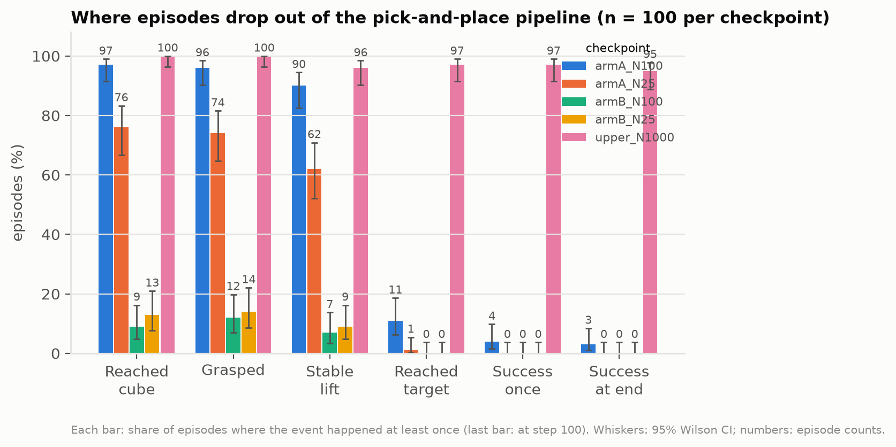

# Phase 3, step 4: does IDM pseudo-labelling help the policy at N = 100?

**Short answer: no. Even with 100 labelled demos, the policy trained on IDM pseudo-labels (arm B) collapses just as it did at N = 25.** It reaches the cube in 9 of 100 episodes, against 97 for the policy trained on the 100 labelled demos alone (arm A). Arm A improves clearly over N = 25 in approach, grasp and lift, but still rarely places the cube (3/100 success on the CPU simulator). One seed.

## Setup (Kaggle T4 x2, 2026-11-09, code `25310a9`)

| | Arm A | Arm B |
|---|---|---|
| Training data | 100 labelled demos, true actions | same 100 + 900 action-free demos with IDM pseudo-labels |
| Episodes / samples | 100 / 7,720 | 1,000 / 77,976 |
| Policy | ACT RGB, official settings, 12,000 steps (LR drop at 8k), seed 0 | identical |
| Training-time evaluation | 100 trials at steps 0, 4k, 8k, 12k, seeded scenes (`physx_cuda`) | identical |

Same runner as N = 25 (`scripts/run_phase3_pair.sh`, `N=100`). Arm B uses exactly the same 1,000 demos and frames as the upper bound (`../upper_N1000/`); only the actions of the 900 action-free demos differ (IDM predictions instead of the true actions).

**IDM label quality** (3-frame window, 3,000 steps, trained on Kaggle on the 100 labelled demos; measured on the 900 action-free demos, `kaggle_idm/metrics.csv`):

| | x R² | y R² | z R² | gripper correct |
|---|---|---|---|---|
| N = 100 (this run) | 0.23 | 0.29 | 0.81 | 94.3% |
| N = 25 (`../policy_N25/`) | −0.17 | 0.11 | 0.61 | 88.1% |

Vertical motion and gripper are labelled well, horizontal motion poorly.

## Results

**Task success during training** (`physx_cuda`, success at end / success once, out of 100):

| Step | 0 | 4,000 | 8,000 | 12,000 (final) |
|---|---|---|---|---|
| Arm A | 0 / 0 | 0 / 1 | 5 / 9 | **4** / 8 (95% CI 2–10%) |
| Arm B | 0 / 0 | 1 / 1 | 0 / 1 | **1** / 1 |

Final training loss: arm A 0.0070, arm B 0.040.

**Where episodes drop out** (final checkpoints, failure analysis on 100 identical scenes, `physx_cpu`, scene seed 10000: the same scenes as the N = 25 arms and the upper bound):

| Event | A, N=25 | **A, N=100** | B, N=25 | **B, N=100** | Upper, 1,000 labels |
|---|---|---|---|---|---|
| Reached the cube | 76 | **97** | 13 | **9** | 100 |
| Grasped | 74 | **96** | 14 | **12** | 100 |
| Stable lift | 62 | **90** | 9 | **7** | 96 |
| Reached target | 1 | **11** | 0 | **0** | 97 |
| Success once | 0 | **4** | 0 | **0** | 97 |
| Success at end | 0 | **3** | 0 | **0** | 95 |

Paired exact McNemar tests on the same scenes ([paired_tests.json](paired_tests.json)):

| Comparison | Reached cube | Grasped | Stable lift | Reached target | Success at end |
|---|---|---|---|---|---|
| A100 vs B100 | 88 vs 0, p = 7e-27 | 84 vs 0, p = 1e-25 | 83 vs 0, p = 2e-25 | 11 vs 0, p = 0.001 | 3 vs 0, p = 0.25 |
| A100 vs A25 | 22 vs 1, p = 6e-6 | 24 vs 2, p = 1e-5 | 31 vs 3, p = 8e-7 | 10 vs 0, p = 0.002 | 3 vs 0, p = 0.25 |
| Upper vs A100 | 3 vs 0, p = 0.25 | 4 vs 0, p = 0.13 | 8 vs 2, p = 0.11 | 86 vs 0, p = 3e-26 | 92 vs 0, p = 4e-28 |
| B100 vs B25 | 7 vs 11, p = 0.48 | 7 vs 9, p = 0.80 | 6 vs 8, p = 0.79 | 0 vs 0 | 0 vs 0 |

("88 vs 0" = scenes where only the first run reached that stage vs only the second.)

Median closest gripper-to-cube distance: A100 0.8 cm, B100 6.0 cm. Median final cube-to-goal distance: A100 8.5 cm, upper 1.1 cm. Arm B does head for the cube (median distance 17 cm at the start, 6.7 cm by step 40), then stops short and drifts away (9.6 cm at step 100); arm A is within 1.2 cm by step 40.

## Interpretation

- **Pseudo-labels still hurt at N = 100, as much as at N = 25.** Better IDM labels (z R² 0.61 → 0.81, gripper 88 → 94%) did not change arm B at all (B100 vs B25: no significant difference at any stage). The horizontal labels stay poor (x, y R² 0.2–0.3), and arm B fails exactly where horizontal precision matters: the last few centimetres of the approach.
- **The cleanest comparison in the project so far: upper bound vs arm B.** Both train on the same 1,000 demos and the same images. With true actions: 95/100 success. With IDM actions for 900 of them: 0/100, and the cube is reached in 9. The only difference is the quality of the action labels.
- **More labels help the labelled-only policy, but mainly in the early stages.** From N = 25 to N = 100, arm A's approach, grasp and lift become nearly reliable (90–97%). Placing at the goal stays rare (11 reached, 3 successes); the upper bound reaches the goal in 97. The precision bottleneck from the baseline appears again.
- **The 12k-step schedule may be short for N = 100.** The earlier 100-demo baseline (30k steps, different seed) scored 16/100 on the CPU simulator and 18/100 on GPU, against 3/100 and 4/100 here. The upper bound showed 12k is enough with 1,000 demos; for 100 demos it may not be. This affects arm A's absolute numbers, not the A-vs-B conclusion (arm B fails long before placement).

## Limits

- One seed per arm.
- The pseudo-label pipeline itself has not been checked end-to-end with *true* labels in place of IDM labels. Arm B failing similarly at N = 25 and N = 100 is consistent with label noise, but a pipeline error (e.g. misaligned labels) would look similar. An "oracle" arm B (same dataset builder, true actions for the 900 demos) should reproduce the upper bound and would rule this out.
- Stage breakdown on the CPU simulator (the simulator the demos were recorded in; see `../upper_N1000/README.md` for the GPU/CPU gap).

## Next experiments this motivates

1. **Oracle check of the arm B pipeline** (one arm, ~3.5 h): build arm B with the true actions as "pseudo-labels". Expect ~95/100 like the upper bound; anything else points to a pipeline bug.
2. **Partial pseudo-labels:** keep the IDM's reliable outputs (vertical motion, gripper) and drop or down-weight the horizontal ones, or train only on the action-free frames where the IDM is confident.
3. **Latent action models**, which learn from the action-free demos without committing to explicit, possibly wrong action labels.

## Files

- `runs/phase3_{A,B}_N100_seed0/`: config, sessions (environment, git commit, dataset hash), metrics (loss and evaluations), per-trial evaluation arrays, `DONE`; `runs/train_{A,B}.log`; `runs/results_table.md`.
- `kaggle_idm/`: IDM label quality on Kaggle and the N = 100 split.
- `failure_analysis/`: CPU stage breakdown for both arms; `label_budget_compare/`: combined summary and figures for A25, A100, B25, B100 and the upper bound (episode files stay in each run's own folder).
- Checkpoints (`final.pt`, 64 MB each) are not committed; they are in the Kaggle kernel output `shahriarmsakib/phase3-pair-n100`.
