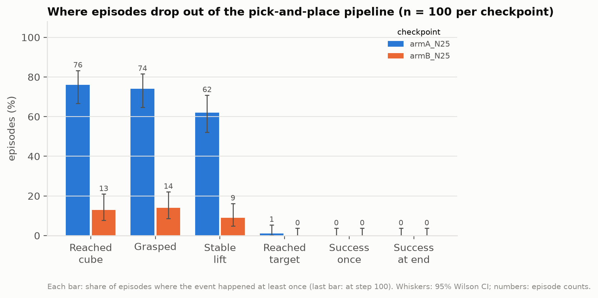

# Phase 3, step 2: does IDM pseudo-labelling help the policy at N = 25?

**Short answer: no. At N = 25 the pseudo-labels made the policy clearly worse.** Neither arm completes the task (0/100), but the policy trained with 900 pseudo-labelled demos rarely even reaches the cube. The policy trained on the 25 labelled demos alone grasps it in 74% of episodes. One seed; a first data point, not a conclusion.

## Setup (Kaggle T4 x2, 2026-11-08, code `2599a97`)

| | Arm A | Arm B |
|---|---|---|
| Training data | 25 labelled demos, true actions | same 25 + 900 action-free demos with IDM pseudo-labels |
| Episodes / samples | 25 / 1,893 | 925 / 72,149 |
| Policy | ACT RGB, official settings, 12,000 steps (LR drop at 8k), seed 0 | identical |
| Evaluation | 100 trials at steps 0, 4k, 8k, 12k, identical seeded scenes (`physx_cuda`) | identical |

The IDM (3-frame window, 3,000 steps) was trained on Kaggle on the same 25 labelled demos. Its labels for the 900 demos on Kaggle-rendered frames: x R² −0.17, y 0.11, z 0.61, gripper 88.1% correct (`kaggle_idm/metrics.csv`). That is close to the Mac measurement for this split (`../idm/`). Demos 0–99 form the labelled pool, demos 100–999 the action-free pool; the labelled ids are in `kaggle_idm/N25_seed0.json`.

## Results

**Task success (training-time evaluation, `physx_cuda`, success at end / 100):**

| Step | 0 | 4,000 | 8,000 | 12,000 (final) |
|---|---|---|---|---|
| Arm A | 0 | 0 | 0 | **0** |
| Arm B | 0 | 0 | 1 | **0** |

**Where episodes drop out** (final checkpoints, failure analysis on 100 identical scenes, `physx_cpu`; [figure](failure_analysis/figures/success_breakdown.png)):

| Event | Arm A | Arm B | Paired test (same scenes) |
|---|---|---|---|
| Reached the cube (gripper within 3 cm) | **76** | 13 | 66 only-A vs 3 only-B, exact McNemar p = 2e-16 |
| Grasped | **74** | 14 | 64 vs 4, p = 6e-15 |
| Stable lift | **62** | 9 | 57 vs 4, p = 5e-13 |
| Reached target | 1 | 0 | |
| Success at end | 0 | 0 | |

Median closest gripper-to-cube distance: arm A 1.7 cm, arm B 5.6 cm.

## Interpretation

- **The 25 labelled demos alone teach approach and grasp, not placement.** Arm A grasps in 74% of episodes but almost never reaches the goal. That is the same precision bottleneck seen in the 100-demo baseline (grasp 97%, target 25%), here more severe with a quarter of the data and 40% of the training steps.
- **Noisy pseudo-labels on 97% of the data pulled the policy off the cube.** At N = 25 the IDM's horizontal labels are worse than predicting the mean (x R² < 0), and ACT fits them: arm B's final training loss is 12x arm A's (0.065 vs 0.0055), and its approach behaviour collapses. Label quality is therefore not a side detail. Below a quality threshold, pseudo-labelling actively hurts.
- This is consistent with the IDM label-quality study (`../idm/`), and with Morin et al. (2026), who note that IDM gains depend on the IDM being easier to learn than the policy. For this camera and action space, small horizontal motions are hard for the IDM.

## Limits

- One seed, one labelled budget, a shortened schedule (12k steps instead of the baseline's 30k): directional evidence only.
- No upper-bound arm yet (ACT on all 1,000 true-labelled demos), so it is not known how much success this step budget allows at all.
- Stage breakdown measured on the CPU simulator (different scenes than the GPU training-time evaluation, identical across the two arms).

## Next experiments this motivates

1. **Upper bound:** ACT on 1,000 true-labelled demos with the same schedule (is the floor the data or the budget?).
2. **Better or filtered pseudo-labels:** use only the dimensions or frames the IDM gets right (e.g. its gripper and vertical predictions), or an IDM with depth and higher resolution, then re-test arm B.
3. **More labels:** N = 50/100, where IDM labels are better (z R² 0.70–0.81, gripper 91–95%).
4. **Latent actions** (the next method arm), which do not commit to explicit wrong labels.
