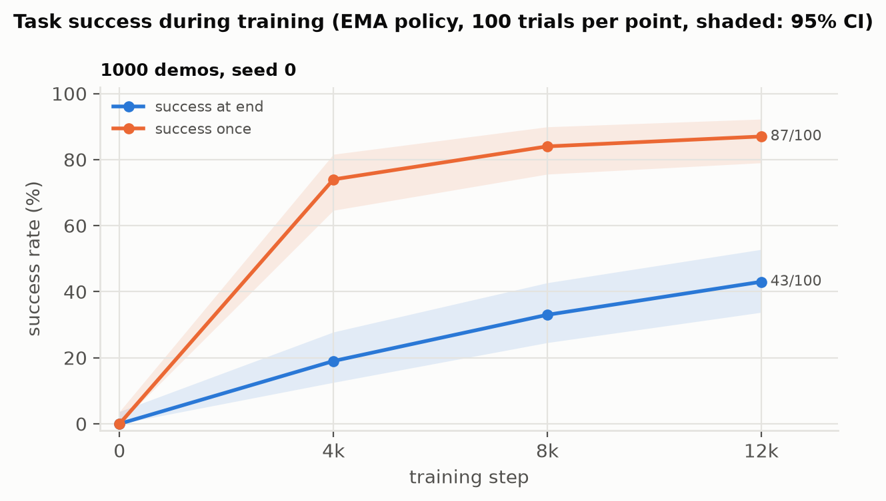
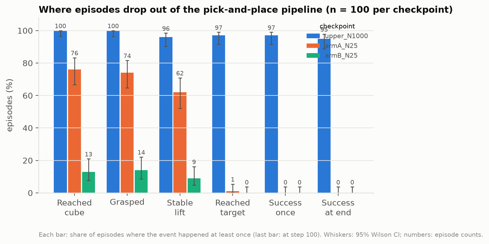

# Phase 3, step 3: upper bound, ACT on all 1,000 true-labelled demos

**Short answer: the 12k-step schedule is enough. The 0/100 at N = 25 comes from too few labels, not too few training steps.** With all 1,000 demos labelled and the same settings, the policy succeeds in **95/100** trials on the CPU simulator, the one the demos were recorded in, and in **43/100** in the training-time evaluation on the GPU simulator. A follow-up check traced the gap to the simulators themselves: on GPU the held cube drifts just outside the 2.5 cm goal tolerance, and even the expert demos' recorded actions fail 12% of the time (see "Simulator gap" below). One seed.

## Setup (Kaggle T4, 2026-11-09, code `05aace1`)

| | Upper bound | Arm A (for reference) | Arm B (for reference) |
|---|---|---|---|
| Training data | 1,000 demos, true actions | 25 demos, true actions | same 25 + 900 IDM pseudo-labelled |
| Episodes / samples | 1,000 / 77,976 | 25 / 1,893 | 925 / 72,149 |
| Policy | ACT RGB, official settings, 12,000 steps (LR drop at 8k), batch 256, seed 0 | identical | identical |
| Training-time evaluation | 100 trials at steps 0, 4k, 8k, 12k, seeded scenes (`eval_seed` 10000, `physx_cuda`) | identical | identical |

Training took about 3.3 h on one T4 (session start 04:15 UTC, finished 07:30 UTC). Demos were replayed to RGB + `pd_ee_delta_pos` on `physx_cpu`, as for every other run (`scripts/run_phase3_upper.sh`). Dataset sha256 and package versions are in `runs/phase3_upper_N1000_seed0/sessions.jsonl`.

## Results

**Task success during training (`physx_cuda`, EMA policy, out of 100):**

| Step | 0 | 4,000 | 8,000 | 12,000 (final) |
|---|---|---|---|---|
| success_at_end | 0 | 19 | 33 | **43** (95% CI 34–53%) |
| success_once | 0 | 74 | 84 | 87 (79–92%) |

Final and best checkpoint are the same here (step 12,000). Success was still rising at the last evaluation. Training loss fell from 1.59 (step 100) to 0.011 (step 12,000); arm A ended at 0.0055 and arm B at 0.065.

**Where episodes drop out** (final checkpoint, failure analysis on the same 100 scenes as arms A and B, `physx_cpu`, scene seed 10000):

| Event | Upper (1,000 labels) | Arm A (25) | Arm B (25 + 900 pseudo) | Upper vs A, paired | Upper vs B, paired |
|---|---|---|---|---|---|
| Reached the cube (within 3 cm) | **100** | 76 | 13 | 24 only-upper vs 0 only-A, p = 1e-7 | 87 vs 0, p = 1e-26 |
| Grasped | **100** | 74 | 14 | 26 vs 0, p = 3e-8 | 86 vs 0, p = 3e-26 |
| Stable lift | **96** | 62 | 9 | 35 vs 1, p = 1e-9 | 87 vs 0, p = 1e-26 |
| Reached target | **97** | 1 | 0 | 96 vs 0, p = 3e-29 | 97 vs 0, p = 1e-29 |
| Success at end | **95** | 0 | 0 | 95 vs 0, p = 5e-29 | 95 vs 0, p = 5e-29 |

p values: exact McNemar test on the discordant scenes ([paired_vs_N25_arms.json](compare_N25_arms/metrics/paired_vs_N25_arms.json)). The 5 upper-bound failures: 2 dropped the cube before the goal, 2 reached the goal but were not successful at the last step, 1 held the cube but never reached the goal. Median closest gripper-to-cube distance: upper 0.7 cm, A 1.7 cm, B 5.6 cm. Median final cube-to-goal distance: upper 1.1 cm, A 17.3 cm, B 19.3 cm.

A second set of 100 CPU scenes (scene seed 20000, [folder](failure_analysis_scenes20000/)) gives 90/100 success at end (grasped 100, reached target 90), so the CPU result does not depend on one lucky scene set.

## Simulator gap: 43/100 on GPU vs 90–96/100 on CPU (diagnosed)

For the 100-demo baseline the two simulators agreed (18/100 GPU, 16/100 CPU; `docs/phase_a_baseline.md`). For this checkpoint they do not. A follow-up Kaggle run (kernel `phase3-gpu-gap-check`, code `6690667`, 2026-11-09, ~10 min on one T4, no training; [files](gpu_gap_check/)) ran the stage breakdown on both simulators with the same weights (sha256 `12e8425a…`) and replayed the recorded demos on both.

| Check | `physx_cuda` (GPU) | `physx_cpu` (CPU) |
|---|---|---|
| Policy, success at end (100 episodes, scene seed 10000, 10 parallel envs) | **43** (reproduces the training-time evaluation exactly) | **96** on Linux; 95 on the Mac (same scenes, 99/100 episodes agree) |
| Reached the goal at some point | 89 | 97 |
| Robot still (static) at the last step | 100 | 100 |
| Reached the goal, not successful at the end | 46, **all still holding the cube outside the goal** | 1 |
| Median final cube-to-goal distance | 2.5 cm (lost episodes: 3.0 cm, range 2.5–4.4) | 1.0 cm |
| Expert demos, recorded actions replayed open-loop (first 100) | **88/100** succeed | 100/100 succeed |

What this shows:

- **Not the platform:** Linux CPU and Mac CPU give the same result on the same scenes.
- **Not robot motion:** the earlier guess (the arm does not settle) was wrong. On GPU the robot is still at the end in every episode.
- **The cube drifts out of the goal while held.** On GPU, 46 episodes bring the cube within 2.5 cm (closest: median 1.4 cm horizontally) and then slowly drift back out, mostly horizontally, ending just outside the tolerance (median 3.0 cm). See [distance over time](gpu_gap_check/failure_analysis_physx_cuda/figures/distance_over_time.png) and the [example video](gpu_gap_check/failure_analysis_physx_cuda/videos/lost_success.mp4).
- **The two simulators respond differently to the same actions.** Even the expert's own recorded actions fail in 12 of 100 demos on GPU, with no learned policy involved. The demos were recorded and converted on `physx_cpu`, so the policy learned CPU-simulator dynamics; on GPU, the same commands place the cube a little off. The task's 2.5 cm tolerance turns that small offset into a large success gap. A plausible reason the 100-demo baseline showed no gap: it mostly failed earlier (short of the goal), before this end-of-episode precision mattered.

Consequences for this project: the CPU simulator matches the training data, so CPU results are the in-distribution measure. GPU training-time numbers stay useful for comparing checkpoints and arms with each other, but not as absolute success rates. Arms are always compared within one simulator. GPU and CPU scenes differ (different random streams), so the GPU-vs-CPU rows above are not paired.

## Interpretation

- **12k steps is enough for this comparison.** With full labels the schedule produces a policy that completes the task (43% GPU, 90–95% CPU). Arm A's 0/100 at N = 25 is therefore mainly a label (data) limit, not a training-length limit. Arm A also trains on 41x fewer samples for the same number of steps, so it already sees each sample far more often; more steps would mostly mean more overfitting.
- **The upper bound beats the 100-demo, 30k-step baseline** (43 vs 18 on GPU, 95 vs 16 on CPU). Ten times more labelled demos matter more than 2.5 times more steps. This is the gap that action-free methods are trying to close.
- **There is a lot of room between 25 labels and 1,000.** Upper vs A: same scenes, 95 vs 0 successes; the upper bound reaches the goal in 97 episodes, arm A in 1. Arm A learned to grasp (74) but not to place.
- The GPU curve was still rising at 12k (19 → 33 → 43), so a longer schedule might add some GPU success for the upper bound. That does not change the conclusion for the N = 25 arms.

## Limits

- One seed. The upper bound is far from both N = 25 arms on every stage, so the direction is clear, but the exact rates are not.
- Large backend disagreement for this checkpoint. Its mechanism is identified (above), but no run has trained on GPU-recorded demos to confirm that this closes the gap.
- The stage breakdown is from the CPU simulator only.

## Files

- `runs/phase3_upper_N1000_seed0/`: config, sessions (environment, git commit, dataset hash), metrics (loss and evaluations), per-trial evaluation arrays, `DONE`; `runs/train_upper.log`: training log; `runs/results_table.md`: auto-generated summary.
- `failure_analysis/`: CPU stage breakdown, scene seed 10000 (same scenes as arms A and B).
- `failure_analysis_scenes20000/`: the same on 100 other CPU scenes.
- `gpu_gap_check/`: GPU and Linux-CPU stage breakdowns with example videos, and demo-replay results on both simulators.
- `compare_N25_arms/`: combined summary and figures for upper vs A vs B; arm A and B episode files are in `../policy_N25/failure_analysis/metrics/`.
- The checkpoint (`final.pt`, 64 MB) is not committed; it is in the Kaggle kernel output `shahriarmsakib/phase3-upper-n1000`.
