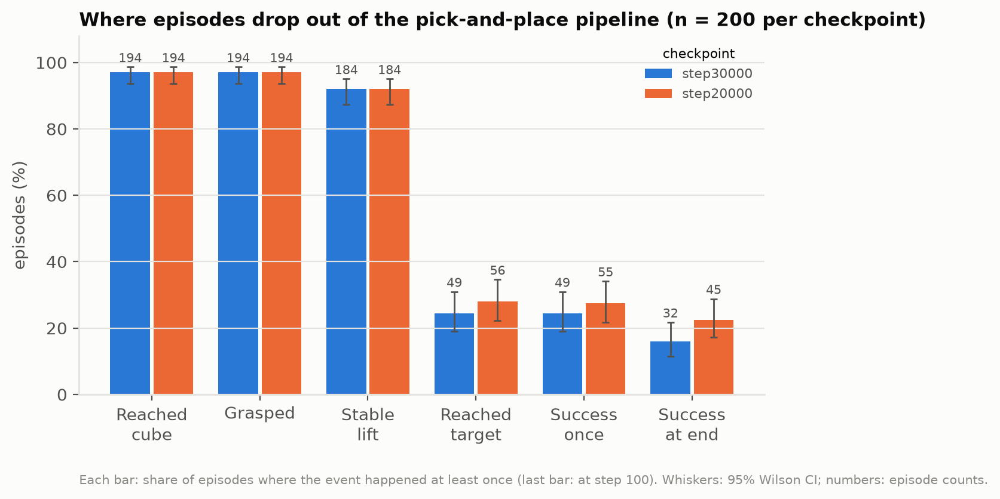
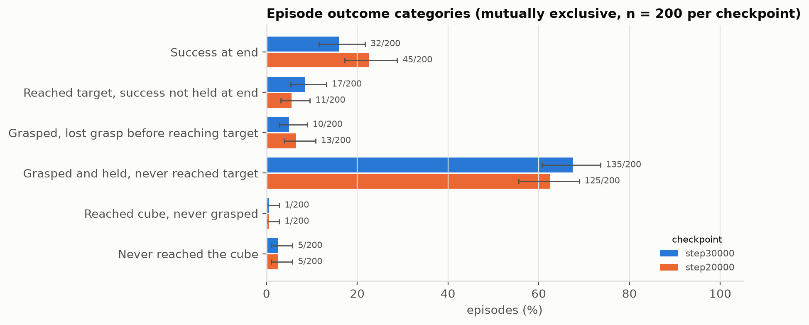
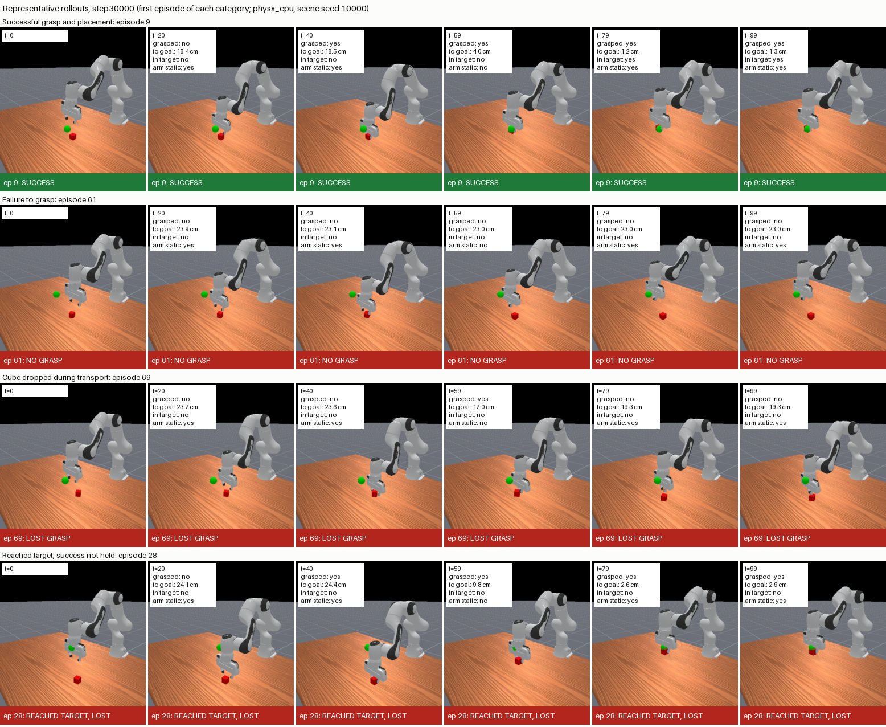
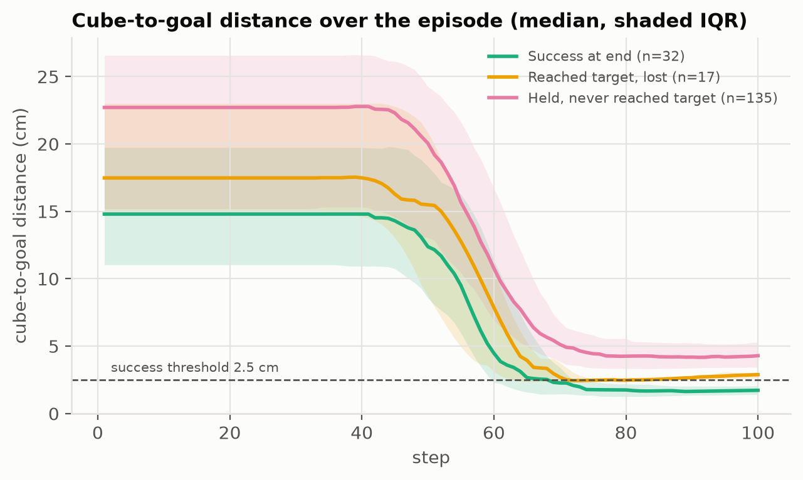
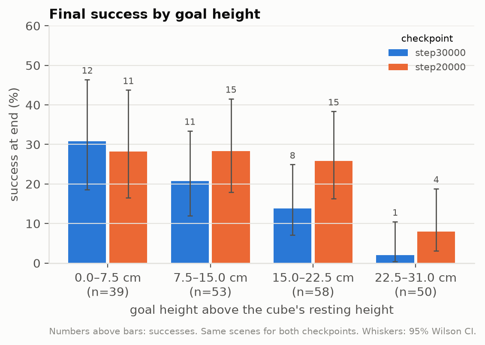

# Phase A failure analysis: why the ACT RGB baseline fails on PickCube-v1

**Summary.** The policy is good at the first half of the task and poor at the second. It grasps the cube in 97% of episodes and lifts it stably in 92%, but brings it within the 2.5 cm goal tolerance in only 25%. The dominant failure (68% of episodes) is *carrying the cube to a point a few centimetres short of the goal and stopping there*: the arm is still at the end of every such episode, typically 4 cm from the goal, with the cube below it. Failure is a goal-positioning precision problem, not a grasping or perception-of-the-cube problem. Simulation only; no real-robot claim is made.

All numbers below come from `metrics/summary.json` and `metrics/episode_metrics.csv`, generated by `scripts/failure_analysis.py` and `scripts/summarize_failure_analysis.py`. No model was trained or modified.

## 1. Setup

| | |
|---|---|
| Policy | ACT RGB baseline `act_pickcube_rgb_baseline_100d_seed1` (100 motion-planning demos, seed 1, `pd_ee_delta_pos`, chunk 30, temporal ensembling) |
| Checkpoints | Final, step 30,000 (`final.pt`, SHA-256 `5e3ebd15…`) and step 20,000 (`step_0020000.pt`, `61f9594c…`), the best checkpoint in training-time evaluation; EMA weights, config verified identical apart from step |
| Episodes | 200 per checkpoint, 100 steps each; 10 parallel envs × 20 batches. Episode ID = batch × 10 + env index |
| Scenes | Scene seed 10000 with `enhanced_determinism=True`: both checkpoints face the identical 200 scenes (verified), and reruns reproduce every outcome exactly |
| Simulator | `physx_cpu` on macOS (the only backend available locally). Training-time evaluation used `physx_cuda` on Kaggle, which samples different scenes |
| Policy inputs | Unchanged: 128×128 RGB camera image plus the standard 29-D state (joint positions/velocities, TCP pose, `is_grasped`, goal position). Diagnostics are read from the simulator into the step *info* only |
| Consistency checks | Per-step reconstruction of `success_once` and `success_at_end` matches ManiSkill's own episode metrics in 200/200 episodes for both checkpoints |

Note on the 18% vs 16% question: on Kaggle's GPU simulator the final checkpoint scored 18/100; here it scores 32/200 = 16.0% (95% CI 11.6–21.7%). The two are consistent; the difference is sampling noise plus different scenes per backend.

## 2. Definitions

Simulator signals (ManiSkill 3.0.1, PickCube-v1): **in target** (`is_obj_placed`) = cube centre within 2.5 cm of the goal; **arm static** = every arm joint slower than 0.2 rad/s; **success** = in target AND arm static; **grasped** = both fingers in contact with ≥ 0.5 N at ≤ 85° (`agent.is_grasping`). The goal can be up to 30 cm above the table, so most goals require holding the cube in the air. The goal marker is hidden from the camera: the policy knows the goal only through the goal position in its state vector.

| Metric (per episode) | Definition |
|---|---|
| Reached cube | gripper centre (TCP) within 3 cm of the cube centre at some step |
| Grasped | `is_grasped` true at some step |
| Stable lift | grasped and cube ≥ 1 cm above its resting height for ≥ 5 consecutive steps |
| Reached target | in target at some step |
| Success once / at end | success at some step / at step 100 |

Mutually exclusive outcome categories, assigned in this priority order:

1. **Success at end**
2. **Reached target, success not held at end**: in target at some step, not successful at step 100
3. **Grasped, lost grasp before reaching target**: grasped, never in target, not grasped at the end
4. **Grasped and held, never reached target**: grasped, never in target, still grasped at the end
5. **Reached cube, never grasped**
6. **Never reached the cube** (TCP never within 3 cm)
7. **Other / ambiguous**: reached the target without ever grasping (did not occur)

Thresholds (3 cm, 1 cm, 5 steps, 3 steps for losing a grasp) were fixed before the results were examined and are stored in `summary.json`.

## 3. Results



| Event (n = 200) | Step 30,000 | Step 20,000 |
|---|---|---|
| Reached cube | 194 (97.0%) | 194 (97.0%) |
| Grasped | 194 (97.0%) | 194 (97.0%) |
| Stable lift | 184 (92.0%) | 184 (92.0%) |
| Reached target | 49 (24.5%, CI 19.1–30.9) | 56 (28.0%, CI 22.2–34.6) |
| Success once | 49 (24.5%) | 55 (27.5%) |
| **Success at end** | **32 (16.0%, CI 11.6–21.7)** | **45 (22.5%, CI 17.3–28.8)** |



| Category (n = 200) | Step 30,000 | Step 20,000 |
|---|---|---|
| Success at end | 32 (16.0%) | 45 (22.5%) |
| Reached target, success not held at end | 17 (8.5%) | 11 (5.5%) |
| Grasped, lost grasp before reaching target | 10 (5.0%) | 13 (6.5%) |
| **Grasped and held, never reached target** | **135 (67.5%, CI 60.7–73.6)** | **125 (62.5%, CI 55.6–68.9)** |
| Reached cube, never grasped | 1 (0.5%) | 1 (0.5%) |
| Never reached the cube | 5 (2.5%) | 5 (2.5%) |

Representative rollouts (`videos/`, and Figure 3 below) are the **lowest-numbered episode in each category**, not hand-picked: success = episode 9, failed grasp = episode 61, dropped during transport = episode 69 (the first lost-grasp episode in which the grasp was lost after a lift), lost success = episode 28. Each frame shows the measured grasp state, cube-to-goal distance, in-target and arm-static flags.



## 4. Failure mechanisms (step 30,000)

**1. Stopping short of the goal while holding the cube: 135/200 episodes.** The cube is carried toward the goal and the motion then stops: the arm is static at the end of all 135 episodes, and the cube-to-goal distance changes by a median of only 0.14 cm over the last 20 steps (median 4.4 cm at step 75, 4.3 cm at step 100). At the closest approach the cube is a median 4.1 cm from the goal (IQR 3.2–5.0): a median 2.9 cm off horizontally and 2.5 cm too low, and it is below the goal in 115/135 episodes. In 101/135 the closest approach is within 5 cm, i.e. these are near misses rather than gross errors. This is not a timeout: the motion has settled tens of steps before the episode ends.



**2. Reaching the target but drifting out: 17/200.** All 17 still hold the cube with the arm static at step 100, a median 2.9 cm from the goal (range 2.5–5.3 cm), after spending a median 14 steps inside the 2.5 cm tolerance. This is the same precision problem at the boundary of the tolerance, not dropping or releasing.

**3. Losing the grasp before the target: 10/200.** In 5 the grasp was lost for ≥ 3 consecutive steps after the cube had been lifted (drops during transport); the other 5 lost contact without such a lifted-then-released pattern (slips around pick-up).

**4. Approach and grasp failures: 6/200.** One episode reached the cube without grasping; five never brought the TCP within 3 cm, but all five came within 3.0–4.2 cm, so they are borderline cases for the threshold rather than clear approach failures.

**Harder scenes fail more.** Final success falls with goal height (12/39 = 31% for goals 0–7.5 cm above the cube's resting height, 1/50 = 2% for 22.5–31 cm; figure `success_by_goal_height.png`) and with the initial cube-to-goal distance (18/67 in the nearest third, 4/67 in the farthest third). Failed episodes start farther from the goal (median 22.7 cm for "held, never reached target" vs 14.8 cm for successes).



## 5. How grasping, reaching the target and success relate

- Grasping is nearly solved: 194/200 grasp, 184/200 lift stably.
- The large loss is between grasp and target: only **49/194 (25.3%) of grasped episodes ever bring the cube into the target.**
- Once in the target, **32/49 (65.3%) finish successfully**; the remaining 17 drift just outside the tolerance.
- Success once equals reached target (49 and 49): whenever the cube entered the target, the arm was also static at some point, so the "static" condition is not what blocks success.

**Step 20,000 vs 30,000.** On the same 200 scenes, the step-20,000 checkpoint succeeds more often: 45 vs 32; 30 scenes succeed under both, 15 only at 20k, 2 only at 30k (exact McNemar test, p = 0.002). Grasping is identical (194/184), so the difference is entirely in goal reaching (56 vs 49) and holding (45/56 vs 32/49). Training past the learning-rate drop at step 20,000 did not help and may have hurt goal precision, consistent with the overfitting suspicion in `docs/phase_a_baseline.md`. On Kaggle's GPU evaluation (100 different scenes, not paired) the two scored 19 and 18, so this effect is established on the CPU simulator only.

## 6. Limitations

- **One training seed, one demo budget.** Mechanisms may differ for other seeds or fewer demos.
- **CPU simulator only.** Scenes differ from Kaggle's GPU evaluation; the 20k-vs-30k difference was not reproduced there (unpaired, n = 100).
- **Thresholds are choices.** The 3 cm approach threshold puts five borderline episodes in "never reached the cube"; categories 2–4 do not depend on it.
- **Correlation, not cause.** Goal height and starting distance are associated with failure; this analysis does not establish why the policy stops short.
- **Demonstration end states not analysed.** Whether the demos themselves finish with the cube near the edge of the 2.5 cm tolerance, or below the goal, was not checked; it would separate "learned from data" from "policy error".
- **Training-time evaluations (Phase A)** used only partly identical scenes (first 10 of 100); this analysis fixes that with `enhanced_determinism`.

## 7. Recommendations

**Priority: goal-reaching precision, not grasping and not cube perception.** Grasp control is already at 97%, and the camera clearly supports finding and grasping the cube. A crop or mask around the cube and gripper (the planned Phase C object-centric variant) targets the part of the task that already works; the goal is not even visible in the image. Object-centric representations should therefore not be the next priority in their planned form.

Suggested order, cheapest first:

1. **Evaluation-only checks (no training):** run the existing checkpoints with temporal ensembling off and with shorter action chunks, to test whether averaging overlapping chunks causes the systematic undershoot. One hour on a Mac with these scripts.
2. **Check the demonstrations:** measure the final cube-to-goal distance and height error in the 100 demos.
3. **Goal conditioning:** in delta-control mode the state vector is not normalised, so the goal position (in metres) enters alongside joint velocities of a different scale. Testing state normalisation, or giving the goal as a goal-relative input, is a direct test of the main hypothesis (requires training).
4. **Phase B (demo budget) remains useful** and is unaffected by this analysis; add the per-episode diagnostics to it, so the data-efficiency curve shows whether more demos improve grasping, transport or final precision.
5. **Checkpoint selection:** report both step 20,000 and 30,000 in Phase B, or shorten training if the 20k advantage replicates on GPU.

If object-centric vision is kept for Phase C, a variant that represents the cube *relative to the goal* would address the measured bottleneck.

## Reproduce

```bash
source scripts/env_macos.sh
python scripts/failure_analysis.py runs/kaggle/act_pickcube_rgb_baseline_100d_seed1/checkpoints/final.pt --label step30000 --videos
python scripts/failure_analysis.py runs/kaggle/act_pickcube_rgb_baseline_100d_seed1/checkpoints/step_0020000.pt --label step20000
python scripts/summarize_failure_analysis.py
```

Checkpoints are not in the repository; download them from the Kaggle notebook output (see `results/README.md`).
